# Ion Thruster - Type EDH

*Multi-stage electrohydrodynamic (EHD) ionic-wind thruster: design study, models and 3-D parts.*

Design study and reduced-order modelling of a compact **cylindrical, multi-stage
electrohydrodynamic (EHD) thruster**. Each stage is a ring emitter (pins, wire or serrated
ring) followed by a ring collector, and the stages are stacked along a 40 mm bore so that
air is accelerated through the middle.

> **Status.** Theory, models, a self-consistent space-charge solver, 3-D part models and a test
> plan are done. **No physical prototype has been built and no measurements exist.** All numerical
> results are labelled as numerical simulation. The space-charge solver ([Phase H](docs/results/spacecharge.md))
> shows the earlier reduced-order absolute numbers are about 3× optimistic. Trends and rankings held.

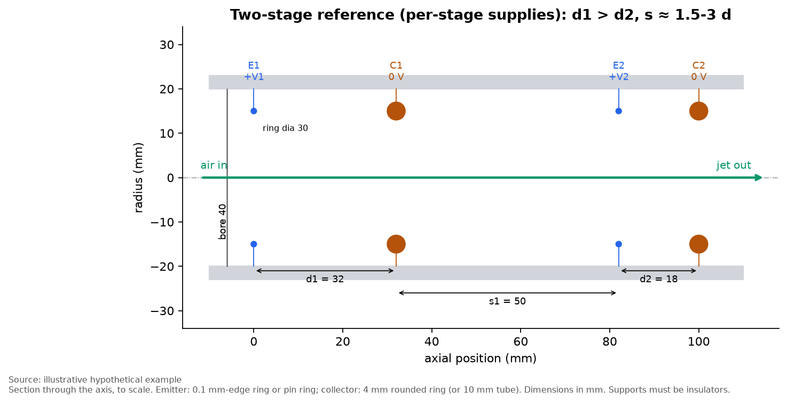

## Summary: what makes the best and most efficient EHD thruster

All of this comes from this project's models (not yet tested on hardware) and the cited literature.

### The one rule behind everything
For every ion that crosses the gap, the push on the air is fixed by how far it travels along the
axis. The power it costs is fixed by the voltage it falls through:

```
thrust / power  =  (axial distance the ions travel) / (ion mobility × voltage)
```

So **efficiency wants long gaps at low voltage, and thrust wants high voltage and high current.**
You cannot maximise both. Every design choice below either moves you along that trade-off or stops
you wasting power on top of it.

### The factors, in order of importance

| # | Factor | Best choice | Why it matters | Confidence |
|---|---|---|---|---|
| 1 | **Spacing between stages** | At least **3× the electrode gap** | Ions from a later emitter drift *backwards* to the previous collector and push the air the wrong way. Back-flow is 49 % of the current at 1× the gap, 16 % at 2×, 6 % at 3×. | High (space-charge solver), needs measurement |
| 2 | **Electrode gap** | The **largest gap your supply can drive to about 85 % of sparkover**. About 30–35 mm for a 30 kV supply. | A longer gap gives more thrust per watt. Beyond what the supply can drive, thrust collapses. | High for the trend; the exact value depends on the measured sparkover |
| 3 | **Operating voltage** | Lower voltage for efficiency, up to the 85 %-of-sparkover limit for thrust | Sets where you sit on the thrust/efficiency trade-off | Physics |
| 4 | **Number of stages** | **1 stage** for best efficiency. **2 stages** for the best balance. **3 only if thrust matters more than power and length.** | Extra stages add thrust at the same voltage, but each costs more power than it returns (third stage: +20 % thrust for +53 % power) | High in the models |
| 5 | **Emitter sharpness** | Fine tips or wire (about 50 µm radius or less) | Sharper tips start the corona at lower voltage, which widens the usable voltage window | High (Peek's law) |
| 6 | **Pin count** | Pin spacing about equal to pin length. That is **12–16 pins on a 30 mm ring**. | More pins add current until neighbouring pins shield each other. Beyond that, more pins make it worse. | Medium (trend robust, optimum approximate) |
| 7 | **Pin direction** | **Axial** (pointing downstream) for thrust. **Radial** for about 30 % better thrust per watt. Never pointing inward. | Radial tips keep the full axial travel distance. Axial tips are closer to the collector, so they draw more current. | Medium |
| 8 | **Collector shape** | A **thin, smooth tube aligned with the flow**, edges well rounded | Electrically, collector types differ by only about 12 %. What matters is how much they block the air. A mesh gains nothing electrically. | Medium (flow-loss values assumed) |
| 9 | **Ring diameters** | Emitter ring as large as the bore allows, with wall clearance. Collector the same size or slightly smaller. | A bigger ring means more emitting length and more current. A larger collector only blocks more flow. | Medium |
| 10 | **Housing** | An **insulating** (plastic) tube. **Never a metal one.** | The plastic tube adds about 7 % force and makes behaviour predictable. A grounded metal tube would arc to the emitter. | High |
| 11 | **Gap per stage** | Equal gaps on one shared supply. Decreasing gaps (for example 32/18/12 mm) only with a separate supply per stage. | With one supply, the smallest gap limits every stage's voltage | Medium |
| 12 | **Air conditions** | Dense, cool air. Expect less in heat or at altitude. | About −24 % thrust at 90 kPa (about 1 km altitude). Humidity changes sparkover. | Medium |
| 13 | **Electrode material** | Choose for durability (stainless needles, aluminium collectors), not conductivity | Electrode resistance wastes about 10⁻⁸ of the power. Sharp copper tips blunt and tarnish. | High |
| 14 | **Inlet and obstructions** | Rounded inlet, thin spokes, nothing extra in the bore | Every obstruction converts thrust into pressure loss | Medium |

### Two recipes

| Goal | Configuration | Model estimate* |
|---|---|---|
| **Most efficient** | 1 stage, 30–35 mm gap, 16 radial needles (wider bore needed) or a fine wire ring, tube collector, run just above corona onset | About 3–10 mN/W (the two models disagree most near onset), but very little thrust (under 1 mN) |
| **Best balance** (recommended build) | 2 stages, 25 mm gaps, 75 mm stage spacing, 16 axial stainless needles, aluminium tube collectors, 40 mm plastic bore, one 30 kV supply at 85 % of sparkover | About 3 mN at about 1.3 W (about 2 mN/W) |

\*Space-charge-corrected where available. Real hardware could differ by 2–3×. The first two tests
to run are back-flow (current measured on each collector separately) and sparkover voltage
(`experiments/test_plan.md`).

## Engineering objectives
Maximise useful airflow and thrust while keeping thrust per watt reasonable. Choose between
two and three stages. Pick electrode spacing, diameters, pin layout and materials. Do this
with evidence whose limits are stated.

## Main findings so far

| Topic | Finding | Evidence |
|---|---|---|
| Gap | Use the largest gap the supply can drive to about 85 % of sparkover. That is about 30–35 mm at 30 kV if sparkover is about 1 MV/m. | [spacing](docs/results/spacing.md) |
| Stage interaction | Ions from a later emitter drift **backwards** to the previous collector and produce negative thrust. With space charge: 49 % of the current at s = d, 16 % at s = 2d, 6 % at s = 3d. **Keep s ≥ 3d.** | [space charge](docs/results/spacecharge.md) |
| Absolute performance | Space-charge solver, single 25 mm stage at 19.5 kV: 34 µA, 1.9 mN net thrust, 2.9 mN/W. That is about 3× below the reduced model. | [space charge](docs/results/spacecharge.md) |
| Housing tube | An insulating bore tube adds about 7 % force and makes the device insensitive to its surroundings. It does not stop back-flow. A metal tube would arc. | [space charge](docs/results/spacecharge.md) |
| d1 > d2 > d3? | Helps **only with a separate supply per stage** (best triple 32/18/12 mm), because stage 1 has no back-flow. With one common supply, equal gaps win. | [spacing](docs/results/spacing.md) |
| 2 vs 3 stages | Extra stages raise maximum thrust (+50–75 %, then +23–40 %) but **lower thrust per watt** at equal power. A third stage mainly adds power. | [stages](docs/results/stages.md) |
| Pins | Neighbouring pins shield each other. Best near pin spacing ≈ pin length (12–16 pins on a 30 mm ring). Axial pins give the most thrust; radial pins give the best thrust/W. | [geometry](docs/results/geometry.md) |
| Collector | Electrical differences are small. A **thin aligned tube** has the lowest flow loss. Mesh is roughly neutral at 70 % open area. | [geometry](docs/results/geometry.md) |
| Materials | Conductivity is irrelevant (I²R about 10⁻⁸ of input). Choose for tip stability and ozone resistance: stainless needles + aluminium tube. | [materials](docs/results/materials.md) |

Full answers to all 16 research questions, with starting configurations:
**[docs/recommendations.md](docs/recommendations.md)**.

## Featured charts

| | |
|---|---|
| 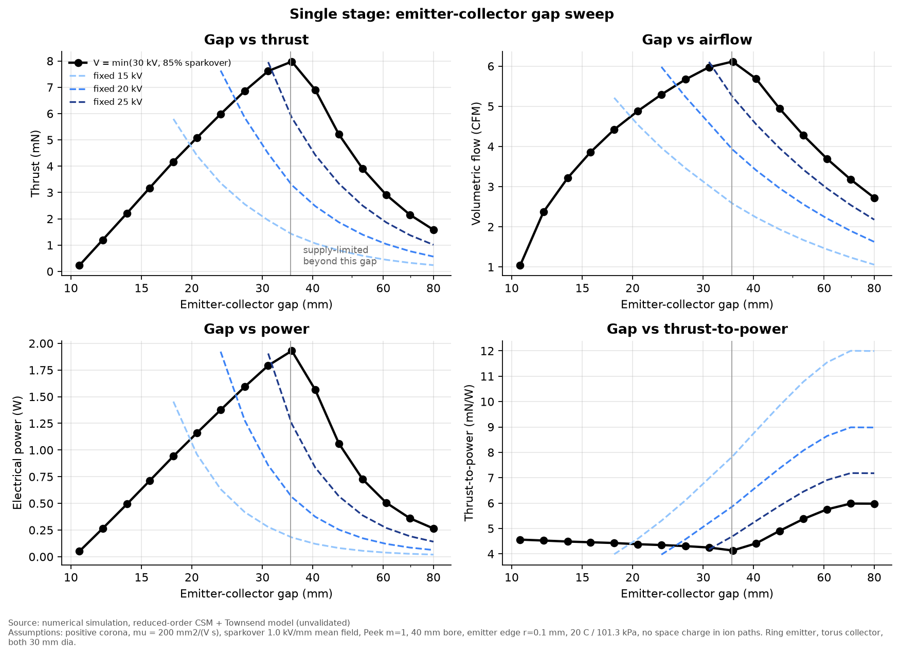 Single-stage gap sweep | 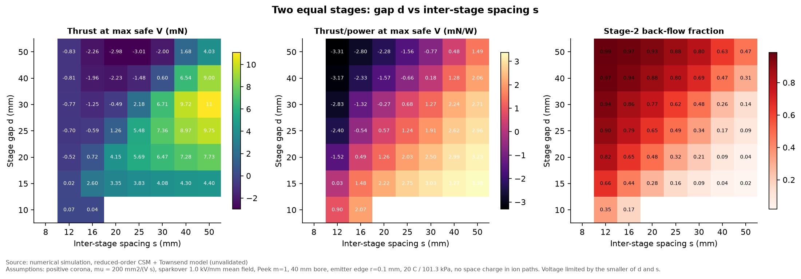 Gap vs inter-stage spacing |
| 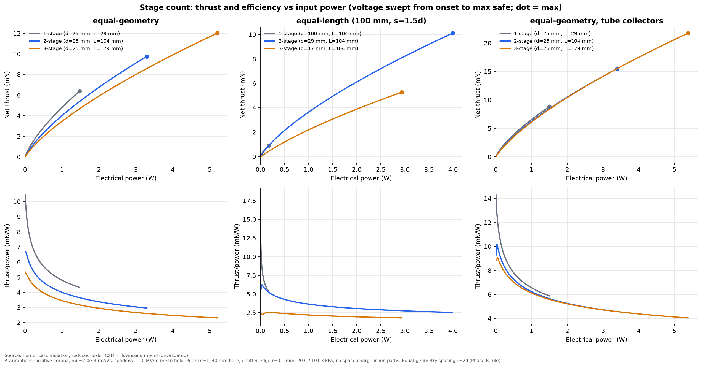 1 / 2 / 3 stages vs power | 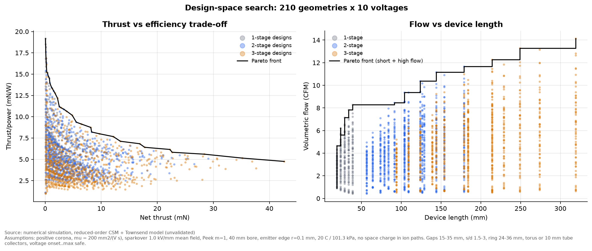 Pareto fronts |
| 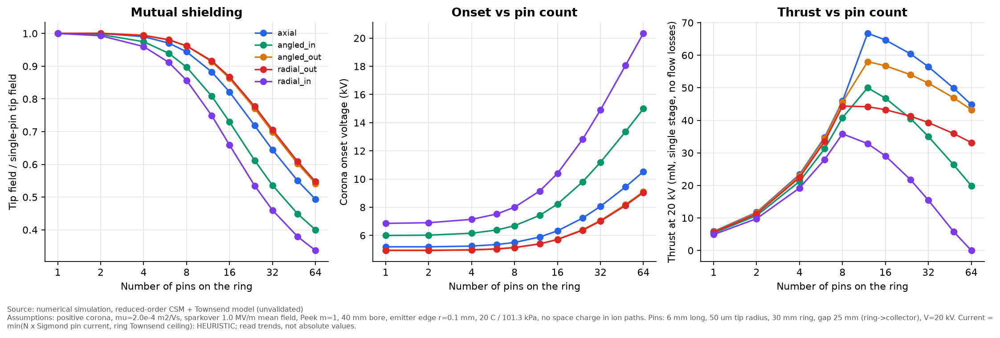 Pin shielding | 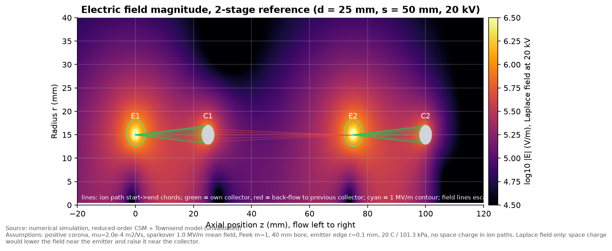 Field and ion paths |
| 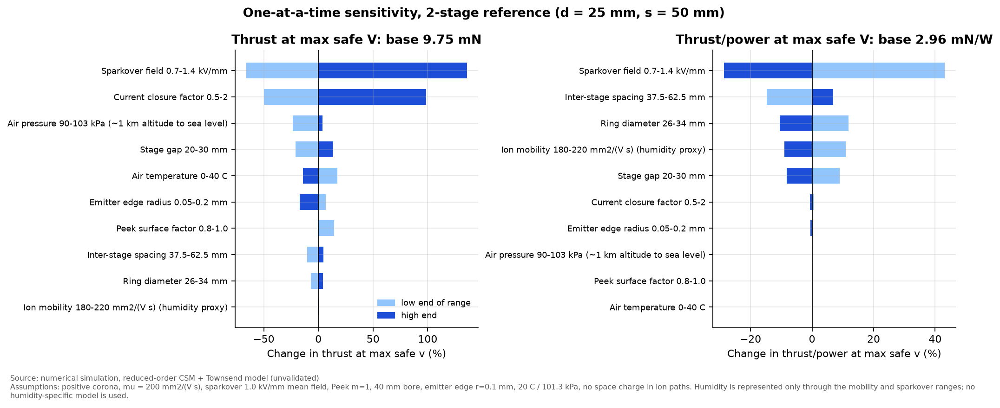 Sensitivity | 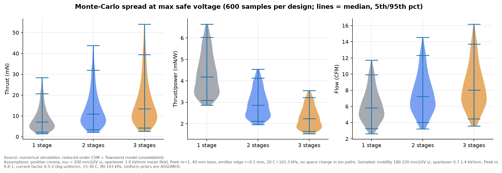 Monte-Carlo uncertainty |
| 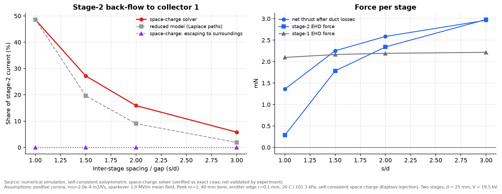 Back-flow with space charge | 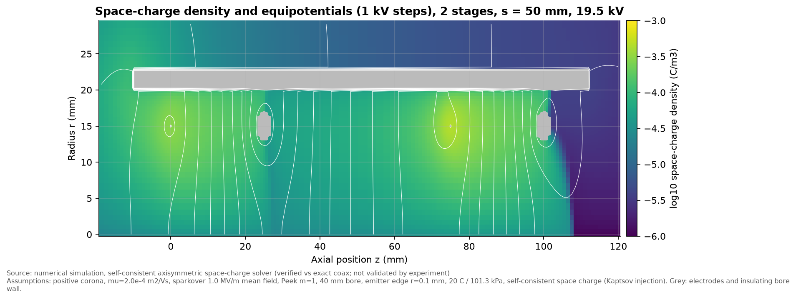 Space-charge density |

Every chart is in `charts/` as PNG and SVG. An interactive design-space explorer is in
`charts/interactive_pareto.html`.

## 3-D design

Every part of the recommended build is modelled in [`cad/`](cad/README.md): printed housing
sections, electrode carriers, brass emitter ring, stainless needles, aluminium collector tubes,
terminals, tie rods and an insulating test stand. Each part is a watertight STL, with 2- and 3-stage
assemblies, interactive viewers and a bill of materials. It is a design proposal and has not been built.

| | |
|---|---|
| 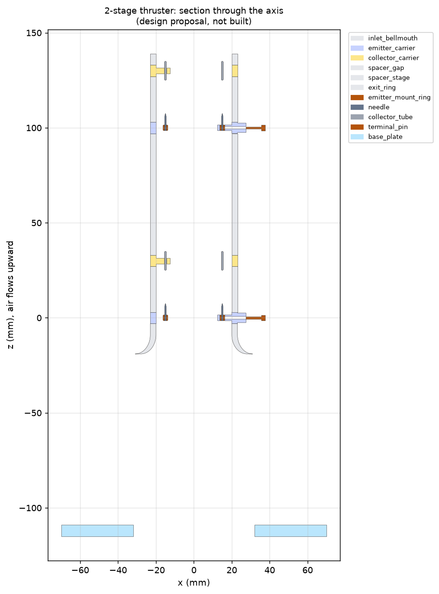 | 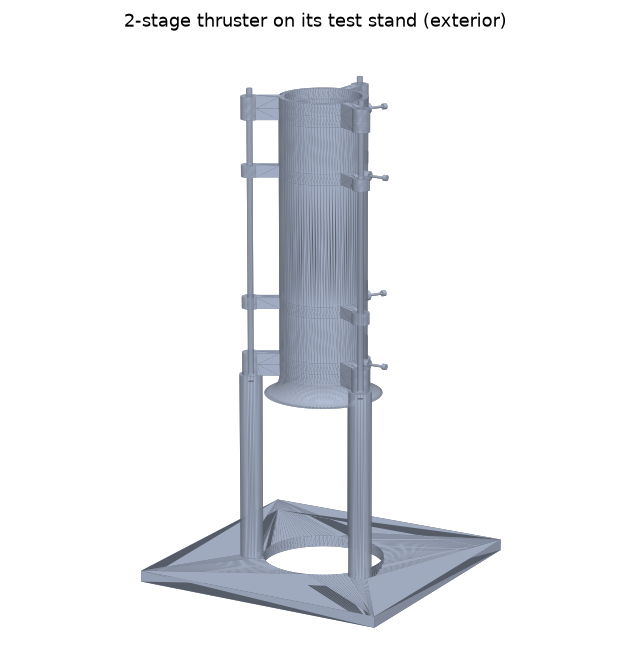 |

## Physics and models in one paragraph
Positive corona at the emitter creates ions. In the drift region they move at `mu E` and pass
their momentum to neutral air. For each ion flux tube, the force is exactly `dI · dz / mu`, where
`dz` is the axial distance between where the tube starts and where it lands. So thrust per watt
is `<dz>/(mu V)`, and ions that land upstream subtract thrust. The repository computes:
the Laplace field of all electrodes with an axisymmetric **charge simulation method**; corona
onset from **Peek's law**; current from **Townsend's** quadratic law applied tube by tube along
traced ion paths; and airflow from a 1-D duct momentum balance with electrode loss coefficients.
A separate **3-D model** handles discrete pins. A **self-consistent space-charge solver**
(Poisson + upwind ion drift with Kaptsov injection, verified against the exact coaxial solution)
checks the reduced model. Navier–Stokes flow is **not** modelled. See [physics](docs/physics.md) and [methodology](docs/methodology.md).

## Repository layout

| Path | Contents |
|---|---|
| `src/ehd/` | Models: `corona.py` (closures), `csm.py` (axisymmetric field solver), `device.py` (multi-stage performance), `pins.py` (3-D pins), `spacecharge.py` (self-consistent solver), `study.py`, `reference.py`, `plotting.py` |
| `simulations/` | One script per study phase (B spacing, C geometry, D materials, E pins, F stages, G sensitivity/Pareto, H space charge), verification, diagrams |
| `data/` | CSV output of every study |
| `charts/`, `diagrams/` | Generated figures (PNG + SVG) |
| `docs/` | Physics, literature review, methodology, results per phase, recommendations, safety, environment |
| `cad/` | Parametric 3-D models of every part (STL), assemblies, interactive viewers, bill of materials |
| `experiments/` | Test plan, CSV templates, uncertainty-reduction script (no data yet) |
| `references/` | Crossref-generated BibTeX and its build script |
| `tests/` | Verification tests (`pytest`) |
| `PROGRESS.md` | Progress log for resuming work |

## Reproduce

```bash
python3 -m venv .venv && .venv/bin/pip install -r requirements.txt   # see docs/environment.md if pip is missing
.venv/bin/python -m pytest
for s in phase_b_spacing phase_c_geometry phase_d_materials phase_e_pins phase_f_stages \
         phase_g_sensitivity_pareto phase_h_spacecharge verification diagrams; do .venv/bin/python simulations/$s.py; done
```
About 25 minutes on 8 CPU cores. No GPU needed.

## Limitations
- Phases B–G use the reduced model (no space charge). Phase H corrects the key numbers, but only for a few axisymmetric cases.
- The space-charge solver is axisymmetric (ring emitters). Discrete pins in 3-D are not solved self-consistently.
- Sparkover is a mean-field criterion (0.7–1.4 MV/m band). It dominates absolute predictions.
- Flow losses use order-of-magnitude correlations, which decide the collector-type ranking.
- Humidity is represented only through parameter ranges.
- The pin model has no housing wall. Radial-outward pins do not fit the 40 mm bore as modelled.

## Future testing
[experiments/test_plan.md](experiments/test_plan.md) ranks the measurements by how much they
would change the conclusions. Most important: **separate current measurement on each collector**
(back-flow) and **sparkover vs clearance**. Read [docs/safety.md](docs/safety.md) before any
high-voltage work.

## References
[Literature review](docs/literature_review.md) and [`references/references.bib`](references/references.bib)
(24 DOI-verified works). Key sources: Masuyama & Barrett 2013 (doi:10.1098/rspa.2012.0623),
Gilmore & Barrett 2015 (doi:10.1098/rspa.2014.0912), Xu et al. 2018 (doi:10.1038/s41586-018-0707-9),
Gomez-Vega et al. 2023 (doi:10.2514/1.J061948), Townsend 1914, Peek 1929, Sigmond 1982.
