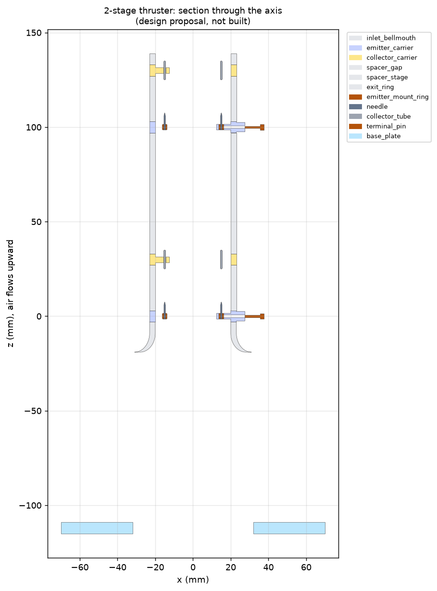

# 3-D part models

**Design proposal: not printed, machined, assembled or tested.** Every part is generated
parametrically by `cad/build.py` (manifold3d + trimesh). All dimensions are in millimetres.
The geometry follows the common-supply recommendation in
[`docs/recommendations.md`](../docs/recommendations.md): 40 mm insulating bore, 16 axial
stainless needles on a 30 mm brass ring, 30 mm aluminium tube collectors, gap d = 25 mm, and
inter-stage spacing s = 75 mm (3d, from the space-charge results).

| Output | What it is |
|---|---|
| `stl/*.stl` | One watertight STL per unique part (13 parts, plus a tie rod per variant) |
| `assembly_2stage.stl`, `assembly_3stage.stl` | Full assemblies on the thrust-test stand |
| `viewer_2stage.html`, `viewer_3stage.html` | Interactive 3-D viewers. Open in a browser and click the legend to hide parts. Needs internet for the Plotly script. |
| `bom_2stage.csv`, `bom_3stage.csv` | Bill of materials: quantity, material, process, envelope, and mass computed from the mesh volume |
| `interference_*.txt` | Pairwise overlap check of every placed part (result: none) |
| `../diagrams/cad_*stage_section.png`, `cad_*stage_exterior.png` | Section through the axis, and exterior render |



## Parts

| Part | Qty (2-stage / 3-stage) | Material | Role |
|---|---|---|---|
| `inlet_bellmouth` | 1 / 1 | PETG or ASA (printed) | Rounded inlet, which reduces entry loss. Carries the bottom tie-rod lugs. |
| `emitter_carrier` | 2 / 3 | PETG or ASA | Bore ring with 3 spokes holding the emitter ring. HV wire channel through the 0° spoke to a boss. |
| `emitter_mount_ring` | 2 / 3 | Brass | 30 mm ring, 2.5 × 3 mm section, 16 × Ø0.82 mm needle holes |
| `needle` | 32 / 48 | Stainless 304 (bought) | Ø0.8 mm, 6 mm exposed, about 50 µm tip, pointing downstream |
| `collector_carrier` | 2 / 3 | PETG or ASA | Bore ring with 3 spokes gripping the collector tube. Spokes are rotated 60° from the emitter spokes to lengthen surface creepage paths. |
| `collector_tube` | 2 / 3 | Aluminium 6061 | Ø30 mm mean, 1 mm wall, 10 mm long, rounded edges |
| `spacer_gap` | 2 / 3 | PETG or ASA | 24 mm bore spacer that sets d. Print several lengths to test other gaps. |
| `spacer_stage` | 1 / 2 | PETG or ASA | 64 mm bore spacer that sets s |
| `exit_ring` | 1 / 1 | PETG or ASA | Top ring with tie-rod lugs |
| `terminal_pin` | 4 / 6 | Brass | HV feed (emitters) and ground return (collectors), on the carrier bosses |
| `tie_rod_*stage` | 3 / 3 | Nylon M3 | Clamp the stack. Insulating. |
| `standoff` | 3 / 3 | PTFE or acetal | 100 mm insulating legs (see `experiments/test_plan.md`) |
| `base_plate` | 1 / 1 | Polycarbonate or acetal | Sits on the balance. A 64 mm hole lets air into the inlet. |

Flying mass (thruster without stand): **about 121 g (2-stage), about 190 g (3-stage)**, mostly the
printed housing. A thinner wall or lighter print settings would reduce it.

## Design notes and open issues
- **Creepage:** the surface path from emitter to collector along the printed bore is about
  40 mm with the 60° spoke offset, about 1.6× the 25 mm air gap. That is below the 2–3× guideline
  in the recommendations. If surface tracking or charging shows up, add ribs or grooves to the bore
  between carriers.
- **Collector section:** the simulations used a 4 mm-thick rounded collector. The CAD tube has a
  1 mm wall, which is lighter and blocks less air, but its sharper edges could start a reverse corona at
  high voltage. Round the edges to at least 0.5 mm radius.
- **HV wiring:** the terminal pin does not reach the emitter ring. Run a short silicone-insulated
  HV wire through the spoke channel (Ø1.4 mm) and solder or crimp it to the brass ring.
- **Needle retention:** the holes are modelled 0.04 mm oversize. Fix the needles with a drop of
  adhesive or a clamping collar. Do not solder stainless.
- **Bore wall:** the space-charge model treats the printed bore as a fully charged-up insulator.
  The first minutes of operation, while it charges, will behave differently.

## Rebuild / change a parameter
```bash
.venv/bin/python cad/build.py     # edit the Cfg dataclass (gap, spacing, pins, bore...) first
```
