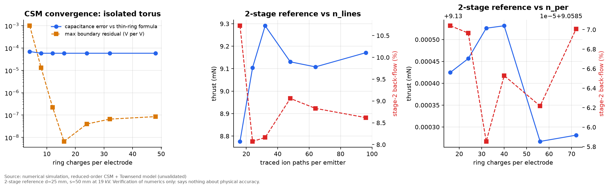

# Simulation methodology

This document covers numerical methods, boundary conditions, solver settings, convergence
and validation status. The physics and closures are in [`physics.md`](physics.md).

## 1. Model hierarchy

| Level | What it computes | Code | Status |
|---|---|---|---|
| 0 | Analytical closures: Peek onset, Townsend and Sigmond currents, hyperboloid tip field, sparkover | `src/ehd/corona.py` | Classical formulas, unit-tested against reference values |
| 1 | Axisymmetric Laplace field of all electrodes (CSM, ring charges) | `src/ehd/csm.py` | Verified against exact capacitances |
| 2 | Ion-path tracing, per-tube Townsend current, drift-limit thrust, 1-D duct flow | `src/ehd/device.py` | Reduced-order. Unvalidated. |
| 3 | 3-D CSM of discrete pins (spheroid line charges + ring charges, N-fold symmetry) | `src/ehd/pins.py` | Verified against exact spheroid capacitance. Current closure heuristic. |
| 4 | Self-consistent axisymmetric space charge (Poisson + upwind drift, Kaptsov injection) | `src/ehd/spacecharge.py` | Verified against the exact coaxial solution (≤ 1.8 %). Unvalidated. |
| — | Navier–Stokes flow with EHD body force | not implemented | Future work |

**Nothing in this repository is a complete EHD airflow simulation.** Level 2 couples an
electrostatic field (no space charge) to a 1-D momentum balance.

## 2. Electrostatics (level 1)

- **Method:** Charge Simulation Method ([Singer et al. 1974](https://doi.org/10.1109/TPAS.1974.293898)).
  Each electrode is a body of revolution with a rounded-rectangle cross-section (torus, washer,
  tube, disc). Ring charges sit inside each body, offset inward from the contour by
  min(1.5 × contour spacing, 0.6 × half-thickness).
- **Boundary conditions:** Dirichlet on every electrode surface (emitters at V × stage scale,
  collectors at 0). Potential → 0 at infinity, satisfied exactly by the ring-charge kernel. The
  housing is assumed to be a perfect insulator with no surface charge, which is not modelled.
- **Solver:** dense least squares (`numpy.linalg.lstsq`) with 2 collocation points per charge,
  column-scaled. Accuracy is checked on an independent set of points between the collocation points.
- **Kernel:** exact ring-charge potential and field with complete elliptic integrals (SciPy). The
  radial field formula was derived and unit-tested against a numerical gradient (relative error
  below 10⁻⁵).
- **Settings used in studies:** 40 ring charges per electrode. Boundary residual is typically
  below 10⁻⁷ V per applied volt.

## 3. Ion paths and current (level 2)

- Field lines start just outside each emitter at `n_lines` points spaced evenly around its
  cross-section. Each carries a weight equal to its electric flux (`E_n × dA`).
- **Integration:** vectorised fixed-step RK4 along the unit field direction. The step is
  0.25 × distance to the nearest electrode, clipped to [2 µm, 1.5 mm]. Integration stops on entering
  any electrode (signed-distance test) or leaving a 0.3 m × 0.8 m box (counted as "escaped").
- **Current:** each tube carries `f_i × I_coax(L_i)`, using Townsend's coaxial law with the
  outer radius replaced by the tube length. This weights short paths heavily. It is a heuristic,
  and its magnitude uncertainty is carried as the factor `k_scale` ∈ [0.5, 2].
- **Thrust:** `sum(dI_i dz_i) / mu_eff`, with the ion-slip-corrected mobility. Flow: fixed-point
  iteration (≤ 8 passes, tolerance 10⁻⁶ m/s) on `u = sqrt(F / (rho A (1 + K/2)))`.

## 4. Convergence (`simulations/verification.py`, chart V1)

| Quantity | Setting | Result |
|---|---|---|
| Torus capacitance vs thin-ring formula | 12+ charges | 6×10⁻⁵ relative difference (the formula itself is asymptotic) |
| 2-stage thrust vs ion paths per emitter | 16 → 96 | 8.78 → 9.17 mN. At 48 paths (used in studies) within ±2 % of the 64–96 values |
| 2-stage back-flow vs ion paths | 16 → 96 | 10.7 → 8.6 %. At 48 paths: 9.1 ± 0.3 percentage points |
| 2-stage thrust vs charges per electrode | 16 → 72 | Unchanged to 4 significant figures |

Discretisation error is therefore about 2 %, far smaller than the physical-model uncertainty
(×3, Phase G). Path-count noise is the reason small differences (< 5 %) between
configurations are treated as ties in the results documents.

## 5. Trend checks against published statements

Single stage at a fixed 20 kV, gap 20 → 30 → 40 mm, compared with the four directional
statements in the abstract of [Masuyama & Barrett 2013](https://doi.org/10.1098/rspa.2012.0623):

| Published trend (increasing gap) | Model |
|---|---|
| Higher onset voltage | ✓ (7.8 → 8.1 → 8.3 kV) |
| Less thrust per volt | ✓ |
| More thrust per current | ✓ (93 → 141 → 183 N/A) |
| More thrust per power | ✓ (4.7 → 7.1 → 9.1 mN/W) |

This is a **qualitative consistency check, not a validation.** No published data points were
digitised or fitted.

## 6. Validation status

| Item | Status |
|---|---|
| Electrostatic solver | **Verified** (exact solutions) |
| Corona onset (Peek) | Literature closure. Not checked against this geometry. |
| Current magnitude | **Unvalidated.** Factor-of-2 band assumed. |
| Back-flow fraction | Space-charge solver gives higher values than the reduced model (16 % vs 9 % at s = 2d). **Unvalidated.** The most important open question. |
| Thrust and flow | **Unvalidated.** Qualitative trend agreement only. |
| Pin model | Verified kernel. Current closure is heuristic. |

## 7. Computational cost

Single geometry: 0.5–2 s (CPU). Full study set: about 25 minutes on 6 worker processes.
The GPU was not used (`docs/environment.md`).
