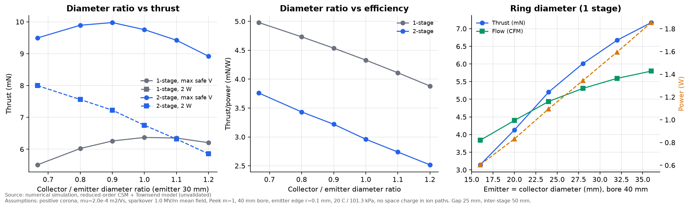
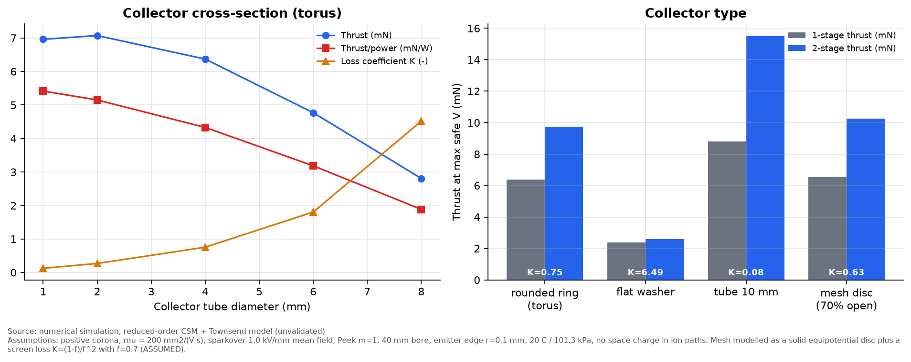
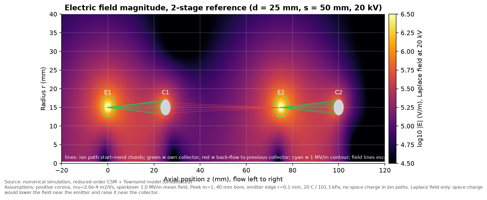
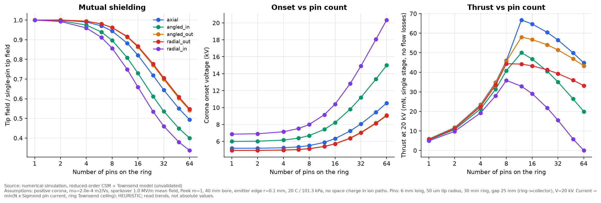
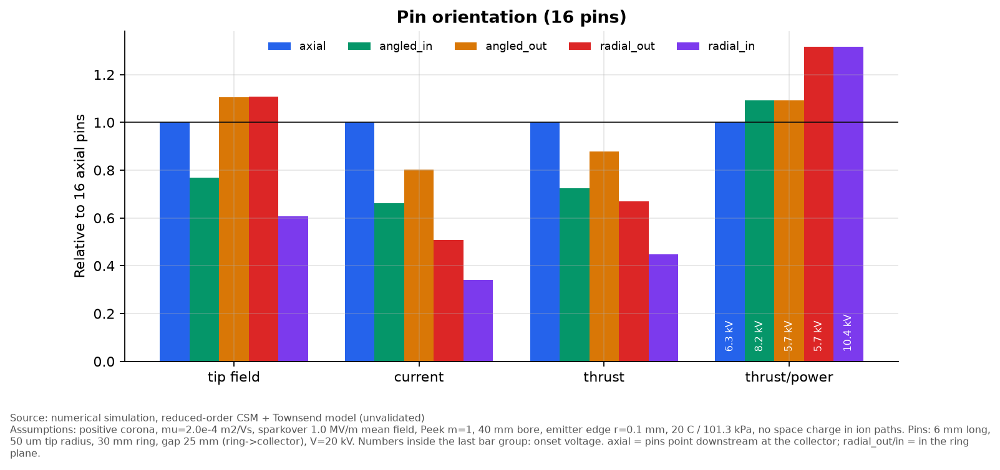
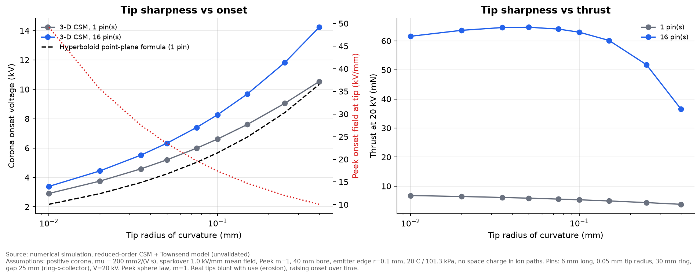

# Phases C and E: ring diameter, collector shape and emitter pins

**Result type: numerical simulation (reduced-order models, not validated against experiment).**
Scripts: `simulations/phase_c_geometry.py` (axisymmetric ring model) and
`simulations/phase_e_pins.py` (3-D pin model). Data: `data/phase_c_*.csv`, `data/phase_e_*.csv`.

## C1: ring diameters (40 mm bore, gap 25 mm, two-stage spacing 50 mm)

| Configuration | Thrust at max safe V (mN) | T/P (mN/W) | Flow (CFM) | Loss K |
|---|---|---|---|---|
| 1 stage, Dc/De = 20/30 | 5.5 | 5.0 | 5.1 | 0.39 |
| 1 stage, Dc/De = 30/30 | 6.4 | 4.3 | 5.5 | 0.75 |
| 1 stage, Dc/De = 36/30 | 6.2 | 3.9 | 5.4 | 1.07 |
| 2 stage, Dc/De = 24/30 | 9.9 | 3.4 | 6.8 | 1.03 |
| 2 stage, Dc/De = 30/30 | 9.8 | 3.0 | 6.8 | 1.51 |

- **Collector larger than emitter:** current rises (+9 % from 30 to 36 mm) because the collector
  presents more area to the corona, but thrust does not, because the extra ring
  sits closer to the bore wall and blocks more flow. The model shows **no clear
  benefit to a larger collector**. A slightly smaller collector (ratio 0.8–0.9) is as
  good or better, mainly through lower flow obstruction and a longer axial lever
  for the ions.
- **Emitter = collector diameter** (16–36 mm in a 40 mm bore): thrust and flow rise with
  diameter because the emitter perimeter, and with it the current, grows. T/P falls as the
  rings crowd the bore. In this model, the largest ring that leaves clearance to the wall
  is preferred for thrust. That clearance is a sparkover and wall-charging risk in practice.
- **Diameter progression across stages** (constant, 24→34, 34→24 mm): all within
  ±3 %, which is below the model's resolution. **No evidence for varying ring diameter
  along the device.**

## C2: collector shape

| Collector | Current (µA, 1 stage) | Thrust 1 stage (mN) | Thrust 2 stage (mN) | Loss K (1 stage) |
|---|---|---|---|---|
| Rounded ring (torus, 4 mm) | 76 | 6.4 | 9.8 | 0.75 |
| Flat washer (8 mm radial) | 85 | 2.4 | 2.6 | 6.5 |
| Tube (10 mm long, thin wall) | 77 | 8.8 | 15.5 | 0.08 |
| Mesh disc (70 % open) | 72 | 6.5 | 10.3 | 0.63 |

- **The electrical differences between collector types are small** (±12 % current).
  The ranking is set almost entirely by the **assumed aerodynamic loss coefficients**,
  which are order-of-magnitude correlations, not measurements.
- A **thin tube collector aligned with the flow** comes out best because it collects ions
  with almost no frontal area. This agrees in spirit with the tubular geometry studied by
  [Rickard & Dunn-Rankin 2007](https://doi.org/10.1016/j.elstat.2007.04.003). Their
  numbers were not compared here.
- **Copper mesh** is roughly neutral in this model. It offers no electrical advantage over a
  ring (it draws slightly less current), and its pressure loss depends strongly on open
  area. At 70 % open area it is comparable to a 4 mm torus. A finer, denser mesh
  (f = 0.5, K = 2.0) would cost more than it gains. **The mesh's real advantage, if any,
  is uniform collection over the bore. That cannot be captured here and needs testing.**
- Thinner collector tubes (C2 left) reduce obstruction faster than they raise the local
  field, so 1–2 mm tube diameter beats 6–8 mm. Sparkover risk from thin collectors is
  not in the model. The collector must stay well rounded relative to the emitter, or it
  will start its own corona.

## C3: field structure

The Laplace field is concentrated at the emitter edges (above 3 MV/m at 20 kV in the
small corona zone). The drift-region field is 0.1–0.5 MV/m. Ion-path chords show the
second emitter's back-flow toward C1 (red). **No charge-density distribution is
plotted.** The model has no space charge, and plotting one would be unsupported.

## E1–E3: discrete pins (3-D model)

The pin model represents each needle as a prolate spheroid with a 50 µm tip radius, 6 mm long,
on a 30 mm ring. It is a separate closure from the ring model, so **absolute numbers
are not comparable with the tables above, only trends within the pin study are**.

**Pin count and shielding (axial pins):**

| Pins | Tip field / single pin | Onset (kV) | Thrust at 20 kV (relative to 16 pins) |
|---|---|---|---|
| 1 | 1.00 | 5.2 | 0.09 |
| 8 | 0.94 | 5.5 | 0.71 |
| 12 | 0.88 | 5.9 | 1.03 |
| 16 | 0.82 | 6.3 | 1.00 |
| 32 | 0.64 | 8.1 | 0.87 |
| 64 | 0.49 | 10.5 | 0.69 |

- Neighbouring pins shield each other. The tip field falls once pin spacing drops below
  roughly the pin length (6 mm). On a 30 mm ring that happens at about 16 pins.
- Thrust rises roughly linearly with pin count up to about 12–16 pins, then falls. Beyond
  that, the corona cannot carry more current than a continuous ring would, and the extra
  shielding raises the onset voltage. **Model optimum: pin spacing about equal to pin
  length (about 12–16 pins here).** The ceiling is a heuristic. The trend (diminishing
  returns, then loss) is robust. The exact optimum is not.

**Orientation (16 pins, same ring-to-collector distance):**

| Orientation | Onset (kV) | Thrust (relative) | T/P (relative) |
|---|---|---|---|
| Axial (pointing downstream at the collector) | 6.3 | 1.00 | 1.00 |
| Angled outward 45° | 5.7 | 0.88 | 1.09 |
| Radial outward | 5.7 | 0.67 | 1.32 |
| Angled inward 45° | 8.2 | 0.72 | 1.09 |
| Radial inward | 10.4 | 0.45 | 1.32 |

- **Axial pins give the most thrust.** Their tips sit closest to the collector, so they draw the
  most current.
- **Radial pins give the best thrust per watt.** Their tips stay in the ring plane, which keeps
  the full axial lever arm `T/P = dz/(mu V)`. At a fixed mechanical gap they draw less current.
- Inward-pointing pins are shielded by the ring itself (onset +30 % to +65 %). Avoid them.
- Outward-radial pins aim their corona at the bore wall. On a dielectric tube this
  **charges the wall**, which can distort the field over time. The model cannot capture
  this.

**Tip sharpness:** onset voltage roughly halves from a 250 µm to a 20 µm tip radius
(16 pins: 11.8 → 4.4 kV). Thrust at a fixed 20 kV changes little below about 100 µm, because
the current is then near the ring ceiling. Sharper tips mainly **widen the operating
window** (onset to sparkover). The 3-D model and the textbook hyperboloid formula agree
within 2–35 % for a single pin (closest for blunt tips). In practice, sharp tips erode and blunt with use, so
tip radius should be measured before and after test campaigns.
