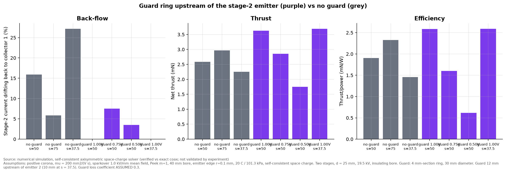

# Phase I: guard ring between stages

**Result type: numerical simulation (space-charge solver, not validated by experiment).**
Script: `simulations/phase_i_guard.py`. Data: `data/phase_i_guard.csv`.

## Idea
Back-flow happens because the stage-2 emitter sits between two grounded collectors, and some
of its ions drift upstream to collector 1. A **guard ring** removes that backward pull. It is a
smooth, blunt ring at the emitter's own voltage, placed just upstream of the emitter. Because it
is at the same potential as the emitter, there is no field between them. Because it is blunt, it
produces no corona of its own. It can be wired directly to emitter 2, so **it needs no extra
power supply**.

## Results (two stages, d = 25 mm, 19.5 kV, insulating bore)

| Configuration | Length (mm) | Back-flow | Net thrust (mN) | Thrust/power (mN/W) |
|---|---|---|---|---|
| No guard, s = 37.5 mm | 92 | 27 % | 2.25 | 1.46 |
| No guard, s = 50 mm | 104 | 16 % | 2.59 | 1.91 |
| No guard, s = 75 mm (current recommendation) | 129 | 6 % | 2.96 | 2.33 |
| **Guard at emitter voltage, s = 50 mm** (12 mm upstream) | 104 | **0 %** | **3.62** | **2.59** |
| **Guard at emitter voltage, s = 37.5 mm** (10 mm upstream) | 92 | **0 %** | **3.69** | **2.59** |
| Guard at 75 % of emitter voltage, s = 50 mm | 104 | 8 % (+22 % lands on the guard) | 2.86 | 1.60 |
| Guard at 50 % of emitter voltage, s = 50 mm | 104 | 4 % (+56 % lands on the guard) | 1.75 | 0.62 |

*Lengths are electrode-stack lengths, as used in the simulation.*

## Findings
1. **A guard at the full emitter voltage removes back-flow completely.** Stage 2's force doubles
   (2.3 → 4.7 mN). Net thrust rises about 40 % over the unguarded device of the same length, and
   thrust per watt rises about 35 %.
2. **It allows a shorter device.** With a guard, a 37.5 mm stage spacing outperforms the unguarded
   75 mm design: the electrode stack is 29 % shorter (92 vs 129 mm), with 25 % more thrust and 11 % better efficiency.
3. **A guard below emitter voltage is counter-productive.** Ions land on it instead, which wastes power.
4. **Checks** (Laplace field at 19.5 kV):

   | Check | Result | Limit |
   |---|---|---|
   | Guard surface field | 3.1–3.2 kV/mm | Peek onset 5.2 kV/mm: no corona |
   | Guard-to-collector-1 field, s = 50 | 0.57 kV/mm | Sparkover ≈ 1 kV/mm: OK |
   | Guard-to-collector-1 field, s = 37.5 | 0.83 kV/mm | 83 % of sparkover: tight against the 85 % margin rule |

## Caveats
- Simulation only. The guard's added flow loss is an assumed K = 0.3.
- The guard must be **smooth and well rounded**. Any burr would start a corona at about 3 kV/mm.
- The guard-to-collector-1 gap becomes the critical sparkover gap, so measure it.
- This is not yet in the CAD model. It is the suggested change for a second prototype (P2),
  once P1 has confirmed the back-flow model.
