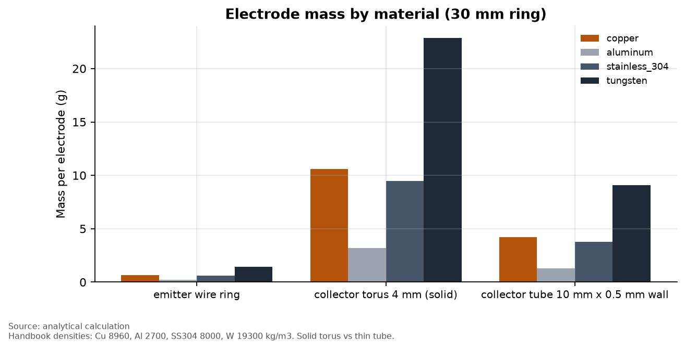
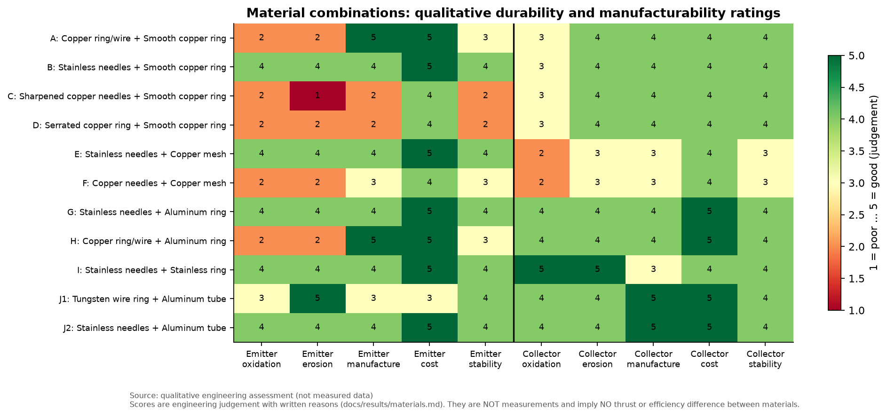

# Phase D: electrode materials

Script: `simulations/phase_d_materials.py`. Data: `data/phase_d_*.csv`.

## 1. Electrical conductivity does not matter here [analytical calculation]

The resistance of a 30 mm ring of 1 mm wire carrying the whole corona current:

| Material | Conductivity (S/m) | Ring resistance (Ω) | Loss at 1 mA (W) | Fraction of 3 W input |
|---|---|---|---|---|
| Copper | 5.96×10⁷ | 0.0020 | 2×10⁻⁹ | 7×10⁻¹⁰ |
| Aluminum | 3.77×10⁷ | 0.0032 | 3×10⁻⁹ | 1×10⁻⁹ |
| Stainless 304 | 1.39×10⁶ | 0.086 | 9×10⁻⁸ | 3×10⁻⁸ |
| Tungsten | 1.79×10⁷ | 0.0067 | 7×10⁻⁹ | 2×10⁻⁹ |

Corona currents are microamps to about a milliamp, and the corona itself has an effective
resistance of tens of megohms. **The bulk conductivity of the electrode has no measurable
effect on performance.** "Copper conducts better" is not a reason to choose copper.

In positive corona, ionization happens in the gas next to the emitter. The electrode
material does not supply the ions. What matters is:
- **surface geometry** (tip/edge radius, sets onset; see `geometry.md`);
- **how that geometry changes over time** (erosion, oxide growth, deposits);
- **mechanical and manufacturing properties.**

Peek's surface factor `m` (0.8–1.0) is where surface condition enters the model.
A rough or oxidized surface (m ≈ 0.8) lowers onset and raised modelled thrust by about 14 % (G1).
So surface condition matters through **onset stability**, not through conductivity.

## 2. Mass [analytical calculation]

A solid 4 mm copper torus collector weighs about 10.6 g, against 3.2 g in aluminum.
A 10 mm × 0.5 mm aluminum tube collector weighs 1.3 g. For a three-stage device, collector choice
alone spans about 4–32 g. **For any application where mass matters, aluminum tube
collectors are about 8× lighter than solid copper rings** and, in the model, also
aerodynamically better (`geometry.md`).

## 3. Durability and manufacturability [qualitative engineering assessment]

**These ratings are judgement, not measurement. No performance difference between
materials has been inferred from them.** Reasons:

| Material / form | Oxidation in ozone + NOx | Tip/edge erosion | Manufacture | Notes |
|---|---|---|---|---|
| Stainless steel needles | Good: chromium-oxide passive film | Good: hard alloy keeps its tip longer than copper | Easy: commercial needles have consistent tips | Hard to solder; use crimp or clamp connections |
| Copper wire / ring | Poor: darkens with oxide; humid NOx forms nitric acid that attacks copper | Fair | Very easy to bend and solder | Fine as a smooth ring; expect visible tarnish |
| Sharpened copper needles | Poor | Poor: soft metal blunts; hand-sharpened tips vary | Hard to make consistent | Tip radius scatter → uneven onset between pins |
| Serrated copper ring | Poor | Fair–poor: teeth tips blunt | Hard: needs cutting or etching | Many small tips. Shielding between teeth applies (`geometry.md`, E1) |
| Tungsten wire | Fair (oxidizes when hot, stable at room temperature) | Very good | Moderate: stiff, hard to solder | The material of choice for thin corona wires in industrial devices |
| Copper mesh collector | Poor: large surface area to tarnish | Fair | Moderate: must be kept flat and taut | Fine wires may start their own corona if too thin |
| Aluminum ring/tube collector | Good: thin native oxide; nanometre film is no barrier at these currents | Good | Very easy; tube stock is cheap | Hard to solder; use clamps |
| Stainless ring collector | Very good | Very good | Moderate to form | Heavier than aluminum |

## 4. Combinations A–J

| | Combination | Assessment |
|---|---|---|
| A | Copper emitter + smooth copper collector | Cheapest to prototype. Expect onset drift as surfaces tarnish. |
| B | Stainless needles + smooth copper collector | Good emitter stability. Collector tarnish is low-risk. |
| C | Sharpened copper needles + copper collector | Least repeatable: hand-sharpened tips vary and blunt. |
| D | Serrated copper ring + copper collector | Continuous ring of tips. Hard to make evenly. Shielding between teeth. |
| E | Stainless needles + copper mesh | Mesh adds flow loss. No modelled electrical gain (`geometry.md`, C2). |
| F | Copper needles + copper mesh | As E, with a less stable emitter. |
| G | Stainless needles + aluminum ring | Durable and light. **Good baseline.** |
| H | Copper emitter + aluminum collector | Light. Emitter tarnish remains. |
| I | Stainless + stainless | Most corrosion-resistant. Heavier. |
| J1 | Tungsten wire ring + aluminum tube | Most erosion-resistant continuous emitter. Lowest-loss collector. |
| J2 | Stainless needles + aluminum tube | **Recommended first build**: commercial parts, durable, low mass, low flow loss. |

## 5. What must be measured
- Onset voltage and I–V curve for each emitter material **before and after** a
  fixed run time (for example 10 h). Onset drift is the stability metric.
- Tip radius under a microscope before and after.
- Collector surface condition (photograph). Weigh electrodes to detect deposits or erosion.

Templates are in `experiments/templates/`.
