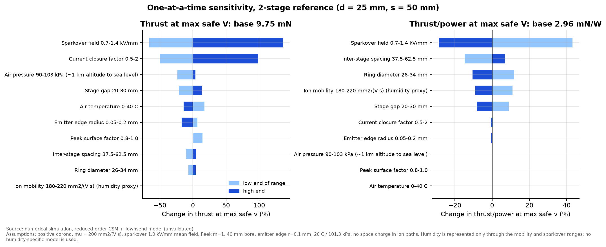
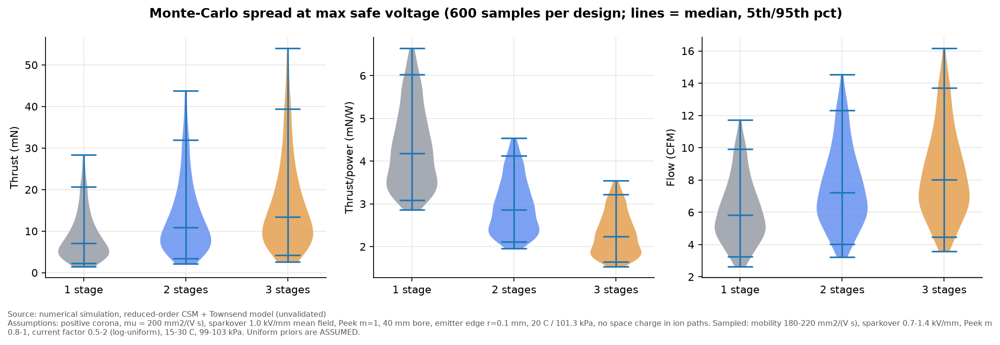
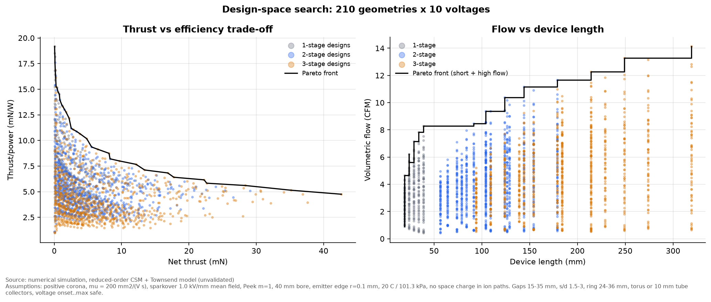

# Phase G: sensitivity, uncertainty and multi-objective search

**Result type: numerical simulation (reduced-order model, not validated against experiment).**
Script: `simulations/phase_g_sensitivity_pareto.py`. Data: `data/phase_g_*.csv`.

> **Read with Phase H.** These results come from the reduced-order model, which has no space charge.
> The space-charge solver ([spacecharge.md](spacecharge.md)) shows its absolute thrust and current are
> about 2–3× too high. Trends and rankings held.

## G1: one-at-a-time sensitivity (2-stage reference, d = 25 mm, s = 50 mm)

Base values at the maximum safe voltage: thrust 9.8 mN, T/P 2.96 mN/W, flow 6.8 CFM, power 3.3 W.

| Factor (range) | Thrust change | T/P change |
|---|---|---|
| Sparkover field 0.7–1.4 MV/m | −66 % / +136 % | +43 % / −29 % |
| Current closure factor 0.5–2 | −50 % / +99 % | ≈0 |
| Air pressure 90–103 kPa | −24 % / +4 % | ≈0 |
| Stage gap 20–30 mm | −21 % / +14 % | +9 % / −8 % |
| Air temperature 0–40 °C | +17 % / −14 % | ≈0 |
| Emitter edge radius 50–200 µm | +7 % / −17 % | ≈0 |
| Peek factor 0.8 (rough) vs 1.0 | +14 % / 0 | ≈0 |
| Inter-stage spacing 37.5–62.5 mm | −10 % / +4 % | −15 % / +7 % |
| Ring diameter 26–34 mm | −7 % / +4 % | +12 % / −10 % |
| Ion mobility 1.8–2.2 ×10⁻⁴ | ≈0 | +11 % / −9 % |

Reading: **the two least-known inputs, sparkover field and current closure, dominate
the absolute thrust.** Sparkover matters because the operating voltage is set as a
fraction of it. Of the geometry choices, gap and spacing matter most, which supports
Phase B's focus. Temperature and pressure act through air density
(Peek's δ and mobility scaling). A 1 km altitude change costs about 20 % thrust at
the safe-voltage operating point. Humidity is **not** modelled physically. It is
represented only through the mobility and sparkover ranges.

## G2: Monte-Carlo uncertainty

600 paired samples per design (common random numbers). Priors are ASSUMED uniform:
mobility 1.8–2.2 ×10⁻⁴ m²/Vs, sparkover 0.7–1.4 MV/m, Peek m 0.8–1.0, current factor 0.5–2
(log-uniform), 15–30 °C, 99–103 kPa.

| Design (d = 25, s = 50 mm) | Thrust 5 / 50 / 95 % (mN) | T/P 5 / 50 / 95 % (mN/W) |
|---|---|---|
| 1 stage | 2.3 / 7.1 / 20.7 | 3.1 / 4.2 / 6.0 |
| 2 stages | 3.4 / 10.9 / 31.9 | 2.1 / 2.9 / 4.1 |
| 3 stages | 4.2 / 13.5 / 39.4 | 1.7 / 2.2 / 3.2 |

- **Absolute thrust is uncertain by roughly ×3 either way.** No single predicted thrust
  number in this repository should be quoted without that band.
- **The rankings are robust to these parameter uncertainties.** In 100 % of paired samples,
  1 stage beats 2 stages and 2 beat 3 on T/P, while 3 beats 2 and 2 beats 1 on thrust
  at the maximum safe voltage. This robustness covers *parameter* uncertainty only. It
  does not cover *structural* uncertainty (the space-charge-free ion paths that set the
  back-flow), which can only be checked by experiment.

## G3: Pareto fronts

210 geometries (1–3 stages, gaps 15–35 mm, s/d 1.5–3, ring 24–36 mm, torus or tube
collectors) × 10 voltages from onset to the maximum safe value.

- **Every point on the thrust/efficiency front uses the largest gap (35 mm), widest spacing
  (s = 3d), largest ring (36 mm) and tube collectors.** The front then moves from
  1 stage at low voltage (high mN/W, tiny thrust) to 3 stages at high voltage. Moving
  along the front is mainly a matter of **voltage and stage count, not geometry**.
- These optima sit on the **edges of the searched range**:
  - The 35 mm gap is close to `V_supply / (0.85 E_sp)`, so it is a physical limit.
  - The 36 mm ring is near the 40 mm bore, so it is a packaging limit.
  - s = 3d is a length trade-off. Longer spacing keeps helping slowly, at the cost of
    device length (right panel).
- Example front points (model values, ×3 uncertainty applies):

| Stages | V (kV) | P (W) | Thrust (mN) | T/P (mN/W) | Flow (CFM) | Length (mm) |
|---|---|---|---|---|---|---|
| 1 | 10.9 | 0.05 | 0.75 | 14.5 | 1.9 | 39 |
| 2 | 17.4 | 1.0 | 8.3 | 8.2 | 6.2 | 179 |
| 3 | 19.5 | 2.5 | 16.9 | 6.8 | 8.9 | 319 |
| 3 | 28.0 | 9.0 | 42.6 | 4.7 | 14.1 | 319 |

The thrust-versus-efficiency trade-off has the same form as the one reported
experimentally for corona EHD by [Gilmore & Barrett 2015](https://doi.org/10.1098/rspa.2014.0912)
and [Xu et al. 2019](https://doi.org/10.1063/1.5100524). That agreement is qualitative only.
