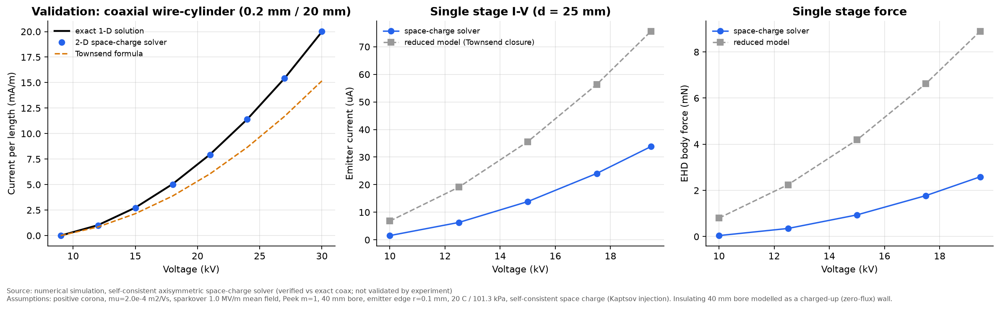
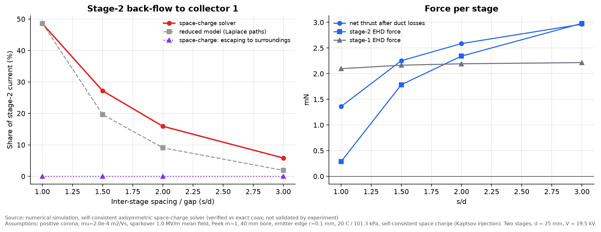
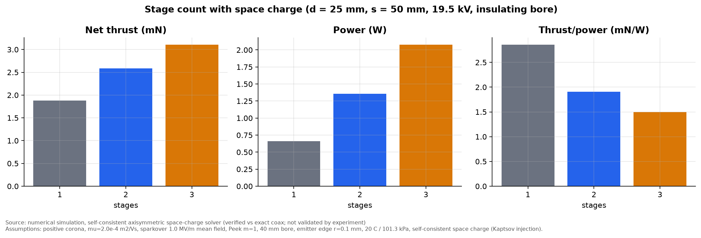
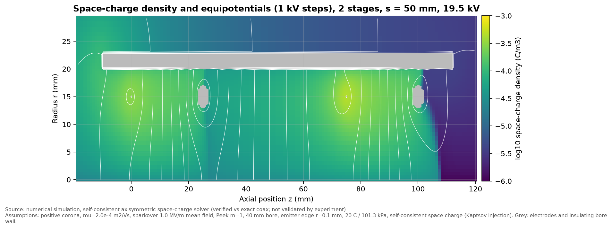

# Phase H: self-consistent space-charge solver

**Result type: numerical simulation.** The solver is verified against an exact solution but
not validated by experiment.
Code: `src/ehd/spacecharge.py`. Script: `simulations/phase_h_spacecharge.py`.
Data: `data/phase_h_*.csv`, `data/phase_h_field_*.npz`.

## What the solver does

It solves Poisson's equation and steady ion drift together on a graded axisymmetric
(r, z) finite-volume grid, iterating until they agree:

- Charge transport uses first-order upwinding.
- Emitter injection follows Kaptsov's assumption: each emitter's charge is held at its
  Laplacian value at corona onset.
- Because transport is linear in the sources for a fixed field, the converged ion cloud
  splits exactly by emitter. That gives the back-flow fraction directly.
- Thrust is the volume integral of `rho E_z`.
- The 40 mm bore can be modelled as **no housing** (open rings in a grounded box 0.3 m away),
  an **insulating tube** (the steady state of a charged-up dielectric: zero normal field and
  zero ion flux at the wall), or a grounded metal tube.

### Verification
| Check | Result |
|---|---|
| Coaxial wire–cylinder vs exact 1-D solution, 12–30 kV | Within 0.1–1.8 % (Townsend's formula is 17–25 % low) |
| Grid refinement (3 → 8 cells across emitter edge, ×1.9 nodes) | Current ±3 %, force ±3 % |
| Outer boundary 0.3 m → 0.5 m (insulating bore) | Force unchanged (2.59 mN). Escaping current 6.5 → 4.0 µA |
| Under-relaxation 0.12 vs 0.3 | Identical to 4 significant figures |
| Charge conservation | Emitted = collected + escaped (to 10⁻⁶) |

## Results (d = 25 mm, 19.47 kV = 85 % of sparkover, insulating bore)

### 1. The reduced model overestimated current and force
| | Reduced model | Space-charge solver |
|---|---|---|
| Single-stage current | 75.6 µA | 33.8 µA |
| Single-stage EHD force | 8.9 mN | 2.6 mN |
| Net thrust after duct losses | 6.4 mN | 1.9 mN |
| Thrust/power | 4.3 mN/W | 2.9 mN/W |

The reduced model's current closure is about **2.2× too high** for this geometry, at the edge
of its assumed factor-of-2 band. About 19 % of stage-1 current escapes from the tube
inlet instead of reaching the collector. Those ions travel upstream, which costs force. **All
absolute thrust and flow numbers in Phases B–G should be read as about 3× optimistic.**

### 2. Back-flow is larger than the reduced model predicted

| s/d | Back-flow, reduced model | Back-flow, space charge | Net thrust, 2 stages (mN) |
|---|---|---|---|
| 1.0 | 49 % | 49 % | 1.36 |
| 1.5 | 20 % | 27 % | 2.25 |
| 2.0 | 9 % | 16 % | 2.59 |
| 3.0 | 2 % | 6 % | 2.96 |

Space charge spreads the ion cloud, so more of the later stage's ions reach the previous
collector. **The spacing rule changes from s ≥ 2d to s ≥ 3d** for back-flow below 10 %.
The single-stage net thrust is 1.88 mN, so with s = d a second stage makes the device
*worse* than one stage.

### 3. Stage count (s = 50 mm, same voltage)

| Stages | Net thrust (mN) | Power (W) | Thrust/power (mN/W) |
|---|---|---|---|
| 1 | 1.88 | 0.66 | 2.86 |
| 2 | 2.59 | 1.36 | 1.91 |
| 3 | 3.10 | 2.08 | 1.50 |

This confirms the earlier conclusion qualitatively. More stages mean more thrust but less thrust per watt.
The third stage adds 20 % thrust for 53 % more power.

### 4. Housing (your "tube around it" question)
| Housing | EHD force (mN, 2 stages) | Notes |
|---|---|---|
| None (open rings, lab 0.3 m away) | 4.2 | About 19 % of stage-1 current drifts far upstream, so stage 1's net force comes out negative (−0.6 mN). The result depends on what is nearby. |
| Insulating tube (charged-up) | 4.5 | About 7 % more force, and **predictable**: stage-1 force +2.2 mN, insensitive to surroundings |
| Grounded metal tube | Not operable | The emitter is 4.9 mm from the wall. At 19.5 kV that is about 4 MV/m, four times the sparkover field. A metal tube would need about 5 kV or less, which is below corona onset. |

So an **insulating** tube helps a little and makes the device behave consistently. It does **not**
fix back-flow, which happens inside the bore. A metal tube does not work at this bore size.

### 5. Charge distribution

The ion cloud fills the bore between each emitter and collector (10⁻⁴–10⁻³·⁵ C/m³). It leaks
upstream from stage 2 toward collector 1 (the back-flow) and out of the tube inlet. The
downstream exit is nearly ion-free.

## Remaining limitations
- Axisymmetric: emitters are continuous rings. Discrete pins need 3-D (where a GPU would help).
- The wind does not convect ions (`u << mu E`, a few % error). No ion diffusion. No ionisation-layer physics.
- The insulating wall is the fully-charged limit. The transient charging is not modelled.
- Sparkover is still the mean-field criterion. The flow is still the 1-D duct model.
