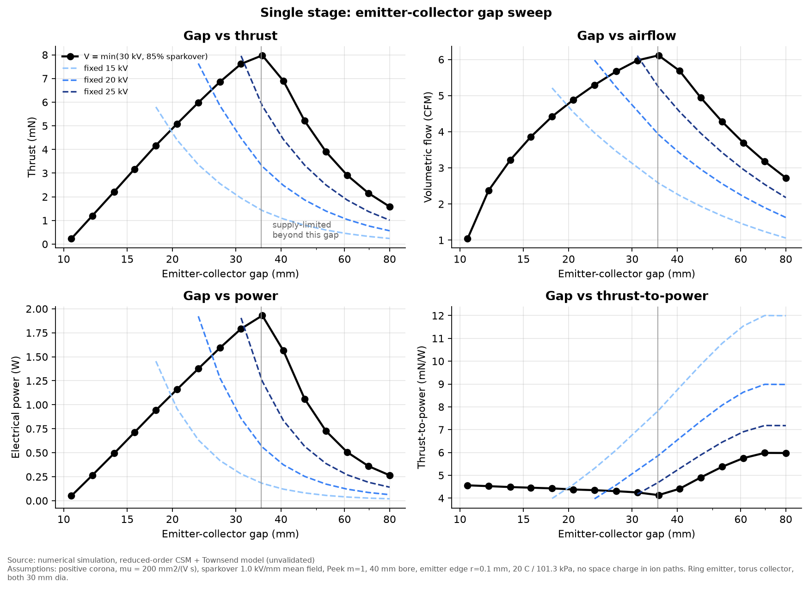
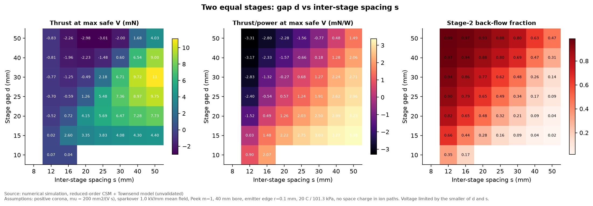
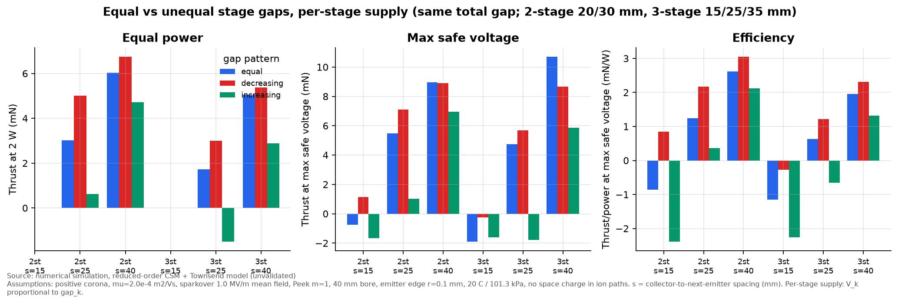

# Phase B: electrode spacing

**Result type: numerical simulation (reduced-order model, not validated against experiment).**

> **Read with Phase H.** These results come from the reduced-order model, which has no space charge.
> The space-charge solver ([spacecharge.md](spacecharge.md)) shows its absolute thrust and current are
> about 2–3× too high, and back-flow is larger, so the spacing rule below becomes **s ≥ 3d**. Trends and rankings held.

Script: `simulations/phase_b_spacing.py`. Data: `data/phase_b_*.csv`. Charts: `charts/B*.png`.

Common conditions: reference ring geometry (30 mm diameter emitter ring with a 0.1 mm
edge radius, 30 mm torus collector with a 4 mm cross-section, 40 mm bore). Air at
20 °C and 101.3 kPa. Assumed supply limit 30 kV. Operating point = the lower of
30 kV and 85 % of the estimated sparkover voltage. Equal-power comparisons are made
at 2 W with the same 85 % cap.

## B1–B5: single stage

| Gap (mm) | Onset (kV) | Operating V (kV) | Thrust (mN) | Flow (CFM) | Power (W) | T/P (mN/W) |
|---|---|---|---|---|---|---|
| 15.7 | 7.5 | 11.6 | 3.2 | 3.9 | 0.71 | 4.5 |
| 27.1 | 8.1 | 21.3 | 6.9 | 5.7 | 1.59 | 4.3 |
| 35.5 | 8.2 | 28.4 | 8.0 | 6.1 | 1.93 | 4.1 |
| 46.5 | 8.4 | 30.0 (supply limit) | 5.2 | 4.9 | 1.06 | 4.9 |
| 80.0 | 8.5 | 30.0 (supply limit) | 1.6 | 2.7 | 0.27 | 6.0 |

Findings:
1. **At a fixed voltage**, thrust per watt rises with the gap (`T/P = <dz>/(mu V)`) while
   thrust falls. This reproduces the trend measured by
   [Masuyama & Barrett 2013](https://doi.org/10.1098/rspa.2012.0623).
   The agreement is with the trend only; their numbers were not used to calibrate the model.
2. **When the voltage is pushed to the sparkover margin**, thrust and airflow grow with
   the gap until the supply limit is reached, then fall. Under these assumptions,
   maximum thrust occurs near `d* ≈ V_supply / (0.85 E_sp) ≈ 35 mm`. The location
   of the optimum scales directly with the assumed sparkover field, which is uncertain
   by about ±40 %. So the defensible statement is: **choose the largest gap that the
   supply can drive to about 85 % of sparkover**, and measure sparkover on the real rig.
3. Breakdown margin (B5) is fixed at 15 % up to `d*` and grows beyond it, because the
   voltage is then supply-limited.

## B6–B8: stage-to-stage interaction

The dominant multi-stage effect in this model is **back-flow**. The emitter of stage
k+1 sits between its own collector (downstream, gap `d`) and the collector of stage k
(upstream, spacing `s`). Ions that drift upstream produce negative thrust but still
draw power.

| d (mm) | s (mm) | Stage-2 back-flow | Thrust at max safe V (mN) |
|---|---|---|---|
| 25 | 12 | 90 % | −0.70 (net reverse) |
| 25 | 25 | 49 % | 5.5 |
| 25 | 40 | 17 % | 9.0 |
| 25 | 50 | 9 % | 9.8 |
| 30 | 50 | 14 % | 11.1 |

- Back-flow is roughly a function of `d/s` alone. It falls below about 10 % only when
  `s ≥ 2d`.
- **Design rule from this model:** inter-stage spacing at least 1.5–2 times the stage
  gap. *(Superseded: with space charge, back-flow is 16 % at s = 2d and 6 % at s = 3d, so use s ≥ 3d.)* Equal `d = s` wastes about half of every later stage's current.

## Equal vs unequal gaps (testing the d1 > d2 > d3 hypothesis)

Two supply arrangements were modelled, because the answer depends on which one is used:

- **Common supply:** every emitter is at the same voltage. The smallest gap then sets
  the sparkover limit for the whole device.
- **Per-stage supply:** each stage's voltage scales with its own gap, so every stage
  runs at the same mean field.

Exhaustive search of 125 gap triples (12–40 mm, s = 25 mm), three stages (B9):

| Supply | Best at 2 W | Thrust (mN) | Best at max safe V | Thrust (mN) |
|---|---|---|---|---|
| Common | 18 / 18 / 18 | 3.7 | 18 / 18 / 18 | 5.8 |
| Per-stage | 32 / 18 / 12 | 4.7 | 40 / 18 / 18 | 7.7 |

Mean over all strictly decreasing vs strictly increasing triples (per-stage supply): 2.8 vs −1.6 mN at 2 W.

Interpretation:
- **The hypothesis holds only with per-stage voltage control, and the reason is
  back-flow, not airflow.** Stage 1 has no upstream collector, so it can use a long,
  efficient gap with no penalty. Later stages benefit from a short gap relative to
  `s`, because that keeps their ions moving forward.
- **With a common supply, equal gaps are best.** An unequal arrangement forces the
  whole device down to the voltage of the shortest gap.
- **Air-speed change between stages is not a significant reason for unequal gaps.**
  The ion-slip correction is `1/(1 + u/(mu E))`, about 2–3 % at the 2–3 m/s speeds
  predicted here.

## Validity limits
- Ion paths come from the Laplace field. Space charge pushes real ion paths outward and
  probably **changes the back-flow fraction**, in an unknown direction.
  The `s ≥ 1.5–2 d` rule therefore needs an experimental check: measure each collector's
  current separately (see `experiments/test_plan.md`).
- Sparkover is a mean-field criterion. The inter-stage gap (emitter k+1 to collector k)
  is included in the limit.
- The flux/L² current weighting is a heuristic built on the Townsend scaling.
