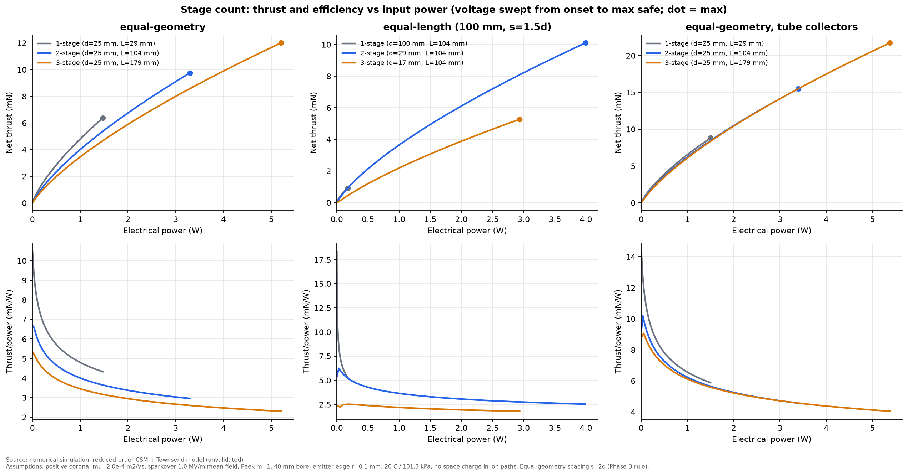

# Phase F: two vs three stages

**Result type: numerical simulation (reduced-order model, not validated against experiment).**
Script: `simulations/phase_f_stages.py`. Data: `data/phase_f_stage_curves.csv`,
`data/phase_f_equal_power_table.csv`.

Each configuration's voltage was swept from onset to the maximum safe voltage (the lower of
30 kV and 85 % of sparkover). This gives a thrust-versus-power curve, from which equal-power
values are read off.

## 1. Identical stages (d = 25 mm, s = 50 mm, rounded-ring collectors)

| Stages | Thrust at 1 W (mN) | T/P at 1 W (mN/W) | Max-safe thrust (mN) | Power at max (W) | Length (mm) |
|---|---|---|---|---|---|
| 1 | 4.8 | 4.8 | 6.4 | 1.5 | 29 |
| 2 | 4.0 | 4.0 | 9.8 | 3.3 | 104 |
| 3 | 3.5 | 3.5 | 12.0 | 5.2 | 179 |

The same comparison with low-loss tube collectors (K about 0.08 per stage):

| Stages | Thrust at 1 W (mN) | Max-safe thrust (mN) | Power at max (W) |
|---|---|---|---|
| 1 | 6.6 | 8.8 | 1.5 |
| 2 | 6.2 | 15.5 | 3.4 |
| 3 | 6.1 | 21.7 | 5.4 |

## 2. Equal overall length (100 mm, s = 1.5 d)

| Stages | Gap (mm) | Max-safe V (kV) | Max-safe thrust (mN) | Power (W) | T/P (mN/W) |
|---|---|---|---|---|---|
| 1 | 100 | 30 (supply limit) | 0.9 | 0.17 | 5.3 |
| 2 | 28.6 | 22.5 | 10.1 | 4.0 | 2.5 |
| 3 | 16.7 | 12.4 | 5.3 | 2.9 | 1.8 |

## Findings

1. **A third stage does not improve efficiency. It increases power consumption.** At equal
   electrical power, thrust and thrust-per-watt fall slightly with each added stage in
   both collector variants (low-loss case: 6.6 → 6.2 → 6.1 mN at 1 W). What extra stages
   buy is **capacity**: at the same maximum safe voltage, three identical stages absorb
   3.5× the power of one and deliver about 1.9–2.5× the thrust.
2. **Why the extra stages don't pay for themselves (model diagnosis, 3 stages at 1 W):**
   stage 1 converts 8.8 mN/W, but stages 2 and 3 only about 6 mN/W. About 14 % of their
   current drifts back to the previous collector. Those ions push backwards over a
   lever arm of `s = 50 mm`, which is *twice* the forward lever. So 14 % of the current
   cancels about 30 % of the stage's thrust. Lower voltage per stage would otherwise raise
   T/P (`T/P = dz/(mu V)`), but the back-flow loss outweighs that gain.
3. **Back-flow loss scales roughly as d²/s.** The back-flow fraction falls about as (d/s)²
   while its lever grows as s. Larger spacing helps, but only slowly, and it costs length.
   A design that physically blocks the back path (a dielectric baffle, or a biased guard
   electrode between stages) might change this conclusion. That is outside the present
   model and is a high-value experiment.
4. **At equal length, two stages beat both one and three.** A single 100 mm gap is limited by
   the 30 kV supply and draws almost no current. Three stages are squeezed into short gaps
   whose sparkover limit (12 kV) caps the voltage.
5. **Aerodynamic losses add up with stage count.** With rounded-ring collectors, K grows from
   0.75 to 2.3 for three stages, which is why the low-loss collector variant narrows the gap
   between stage counts.

## Recommendation from this phase

- If the goal is **thrust or airflow from a fixed supply voltage**, two stages raise
  output by 50–75 %. A third stage adds about another 23–40 % for about 60 % more power and
  75 mm more length.
- If the goal is **efficiency (thrust per watt)**, use one stage, or two with generous spacing.
- These conclusions depend on the modelled back-flow fraction, which rests on the
  space-charge-free ion paths. The decisive measurement is the **current to each collector,
  measured separately**, which gives the back-flow fraction directly (`experiments/test_plan.md`).
