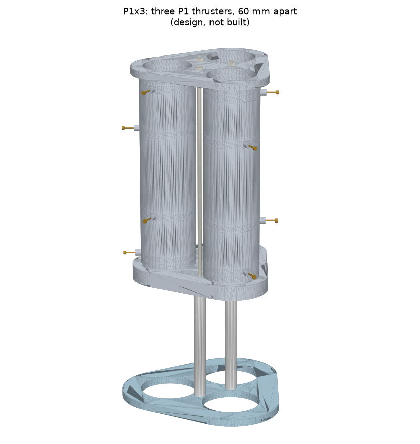
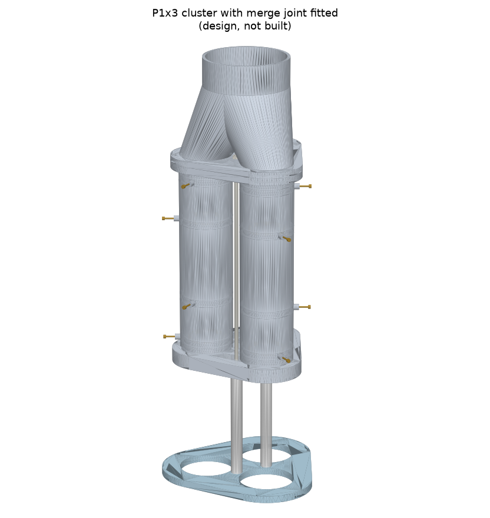
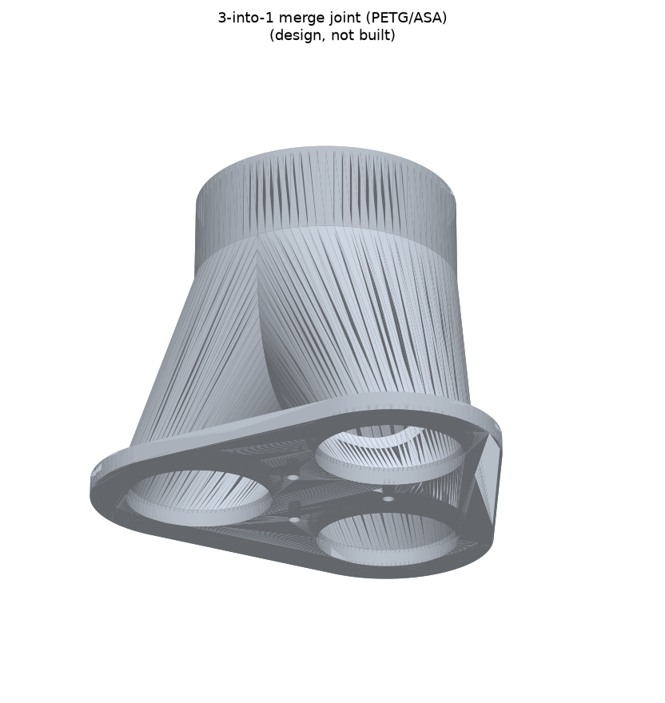
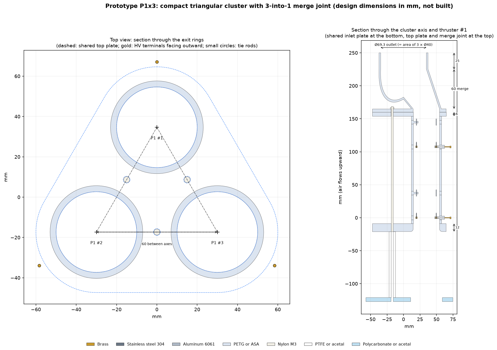

# Prototype P1: two-stage build package

**Status: designed, not yet built.** Every dimension here is a **design dimension** from the
parametric CAD model (`cad/build.py`), in millimetres. The "as built" and "measured" tables at
the end are blank, ready to fill in once P1 is built and tested under the conditions in
[`docs/safety.md`](../docs/safety.md).

Regenerate this folder with `.venv/bin/python prototypes/build_drawings.py` and
`.venv/bin/python prototypes/build_cluster.py`.

## Fully assembled

| Key dimension | Value (mm) |
|---|---|
| Overall length (inlet flare to exit ring) | 173 |
| Bore / housing outside diameter | Ø40 / Ø46 |
| Emitter ring and collector tube diameter | Ø30 (mean) |
| Gap d: needle tip to collector leading edge (both stages) | 25 |
| Spacing s: collector 1 leading edge to emitter 2 ring | 75 (3 × d) |
| Needle exposed length / tip radius | 6 / ≈ 0.05 |
| Collector tube length / wall | 10 / 1 |
| Tie-rod circle | Ø76 |
| Test stand: standoff height / base plate | 100 / 140 × 140 |

## Separated parts

3-D versions: [`P1_viewer_exploded.html`](P1_viewer_exploded.html) (interactive; open in a browser) and
`P1_exploded.stl`. Individual part STLs are in [`../cad/stl/`](../cad/stl/).

## Parts and materials

| Part | Qty | Material | Key dimensions (mm) | Mass each (g) | How to get it / why |
|---|---|---|---|---|---|
| Emitter needle | 32 | **Stainless steel** | Ø0.5–0.8 × 9, 6 exposed, tip ≈ 0.05 | 0.03 | Stainless insect (entomology) pins cut to length. Sharp, consistent, and they keep their tips in ozone. Drill the ring holes to match the pin diameter. |
| Emitter mounting ring | 2 | **Brass** | Ø30 mean, 2.5 × 3 section, 16 holes | 5.7 | Laser- or waterjet-cut from 3 mm brass sheet (online cutting services ship in Canada), or machined. Conductivity doesn't matter at these currents. |
| Collector tube | 2 | **Aluminum** (6061 or similar) | Ø30–32 OD, 1 wall, 10 long, edges R0.5 | 2.5 | Cut from metric 30 × 1 or 32 × 1 tube. Light, cheap, stable oxide, and blocks the least air. |
| Terminal pin | 4 | **Brass** | M2 screw or 2 mm banana jack | 0.2 | HV feed to the emitters, ground return from the collectors |
| Emitter carrier | 2 | **PETG or ASA** (3-D printed) | Ø40/Ø46 ring, 6 thick, 3 spokes | 6.1 | Insulating, and more ozone-tolerant than PLA. A Ø1.4 channel in one spoke carries the connecting wire. |
| Collector carrier | 2 | **PETG or ASA** | Ø40/Ø46 ring, 6 thick, spokes at 60° offset | 6.1 | Offsetting the spokes lengthens surface leakage paths |
| Inlet bellmouth | 1 | **PETG or ASA** | Ø40 bore, Ø62 lip, 16 tall | 11.4 | A smooth inlet reduces entry loss |
| Gap spacer | 2 | **PETG or ASA** | Ø40/Ø46 tube, 31.5 long | 16.2 | Sets d. Print extra lengths to test other gaps. |
| Stage spacer | 1 | **PETG or ASA** | Ø40/Ø46 tube, 64 long | 32.9 | Sets s |
| Exit ring | 1 | **PETG or ASA** | Ø40/Ø46 ring, 6 thick | 5.8 | Clamps the stack |
| Tie rod | 3 | **Nylon** | M3 × 171 | 1.4 | Insulating clamp. No metal path along the device. |
| Insulating standoff | 3 | **PTFE or acetal** | Ø12 × 100, M3 tapped | 23.3 | Test stand only. Isolates the thruster from the balance. |
| Base plate | 1 | **Polycarbonate or acetal** | 140 × 140 × 6, Ø64 air hole | 117.8 | Test stand only. Rests on the balance; the hole lets air reach the inlet. |

**Thruster mass about 129 g; about 317 g on its test stand.** Full list: [`P1_parts_list.csv`](P1_parts_list.csv).

**Also needed:** about 200 mm of bare Ø0.8 mm copper wire (terminal pin to emitter ring, inside
the spoke), about 1000 mm of silicone HV lead rated ≥ 30 kV DC (supply to terminal pin), 6 × M3
nylon nuts, cyanoacrylate or epoxy for the pins, and fine abrasive paper.

## Cost estimate (CAD)

Indicative 2026 prices in Canadian dollars. These are rough ranges for planning, not quotes.
Itemized list: [`P1_cost_estimate.csv`](P1_cost_estimate.csv).

| Category | Indicative cost |
|---|---|
| Prototype parts (everything above) | **$106–305** |
| Test equipment (HV supply, balance, ozone monitor, enclosure, meters) | $820–4 050; usually available in a university lab |

## Assembly sequence (no power connected at any point)
1. Print the PETG/ASA parts with at least 3 perimeters, so the walls are solid and leak-free. Check the bore is Ø40 ± 0.2.
2. Push 16 pins through each brass ring so that **6.0 mm** sticks out on one side. Fix them with a drop of adhesive and trim the backs flush.
3. Solder a short bare copper wire to each ring. Thread it through the spoke channel of an emitter carrier and fasten it to that carrier's terminal pin.
4. Seat each ring in its emitter carrier with the needles pointing **downstream** (toward the exit ring).
5. Deburr both collector tubes and round their edges to at least 0.5 mm. Press each into a collector carrier and wire it to that carrier's terminal pin (ground).
6. Stack from the bottom: inlet bellmouth, emitter carrier 1, gap spacer, collector carrier 1, stage spacer, emitter carrier 2, gap spacer, collector carrier 2, exit ring.
7. Fit the three nylon tie rods through the lugs and tighten the nuts evenly by hand.
8. Screw the tie rods into the PTFE standoffs, and the standoffs onto the base plate, exhaust pointing up.

## As-built dimensional check (fill in after building)

| Check | Design (mm) | Tolerance | As built |
|---|---|---|---|
| Gap d, stage 1 (needle tips to collector leading edge) | 25.0 | ±0.5 | |
| Gap d, stage 2 | 25.0 | ±0.5 | |
| Spacing s | 75.0 | ±1.0 | |
| Needle exposed length (mean of 16, both rings) | 6.0 | ±0.3 | |
| Needle tip radius (microscope, 4 sample pins) | ≈ 0.05 | n/a | |
| Ring concentricity to bore | 0 | ≤ 0.3 | |
| Collector edge radius | ≥ 0.5 | n/a | |
| Thruster mass | ≈ 129 g | n/a | |

## Measured performance (empty until tested)

Model predictions are listed so the measurements can be compared directly. The space-charge
predictions treat each needle ring as a continuous ring, so expect some difference. Record raw data
in [`experiments/templates/`](../experiments/templates/).

| Quantity | Model prediction | Measured |
|---|---|---|
| Sparkover voltage, needle tips to collector | ≈ 25 kV (assumes 1 kV/mm average field) | |
| Corona onset voltage | ≈ 6–7 kV (3-D needle model) | |
| Current at 19.5 kV (both stages) | ≈ 65 µA | |
| Back-flow, stage 2 → collector 1 | ≈ 6 % | |
| Thrust at 19.5 kV | ≈ 3 mN | |
| Thrust/power at 19.5 kV | ≈ 2.3 mN/W | |
| Airflow at 19.5 kV | ≈ 1.8 L/s | |

## P1x3: compact triangular cluster with a 3-into-1 merge joint

Three identical P1 thrusters stand side by side, their axes on the corners of an equilateral
triangle **60 mm apart**, leaving 14 mm between neighbouring housings. To pack them this close, the
single-thruster tie-rod lugs are removed. All three stacks are clamped between two shared plates by
three nylon tie rods running through the gaps between the thrusters. Each thruster is turned so its
high-voltage terminals face **outward**. A printed **merge joint** bolts onto the top plate and blends
the three jets into one outlet. Design only: not built or tested.

| Cluster | With merge joint | Merge joint on its own |
|---|---|---|
|  |  |  |

| Key dimension | Value (mm) |
|---|---|
| Distance between thruster axes | 60 (housings 14 apart) |
| Shared inlet plate | 12 thick; three Ø40 inlets with R4 rounded entries |
| Shared top plate | 6 thick |
| Merge joint | 3 × Ø40 inlets → one Ø69.3 outlet (same area as the three bores combined); 5 flange + 60 merge + 25 outlet = 90 tall; 2.5 wall |
| Tie rods | 3 × M3 × 190, midway between neighbouring thrusters |
| Base plate footprint | 140 × 132 |

| Part | Qty | Material | Mass (g) | Notes |
|---|---|---|---|---|
| P1 thruster stack (lug-free carriers and exit ring, plain inlet ring) | 3 | as P1 | — | Same internals as P1. Each keeps its own HV feed and current measurement. |
| Shared inlet plate | 1 | PETG or ASA | 90 | Rounded inlets built in. M3 threads tapped for the tie rods. |
| Shared top plate | 1 | PETG or ASA | 46 | |
| Merge joint | 1 | PETG or ASA | 113 | Print upright, flange down; the walls lean no more than about 20° from vertical, so no supports are needed |
| Tie rods + nuts | 3 + 3 | Nylon M3 | — | |
| Standoffs | 3 | PTFE or acetal | — | Ø10 × 100, under the tie rods |
| Base plate | 1 | Polycarbonate or acetal | — | Three Ø48 air holes |

**Checks** ([`P1x3_checks.txt`](P1x3_checks.txt)): no parts overlap. The closest high-voltage metal of one
thruster is **39 mm** from grounded metal of another, above the 25 mm needed at 19.5 kV.

**Cost:** about three P1 part sets plus about 250 g more filament: roughly **$330–930 CAD**.

Files: [`P1x3_cluster.stl`](P1x3_cluster.stl), [`P1x3_merge_joint.stl`](P1x3_merge_joint.stl),
[`P1x3_inlet_plate.stl`](P1x3_inlet_plate.stl), [`P1x3_top_plate.stl`](P1x3_top_plate.stl),
[`P1x3_cluster_with_joint.stl`](P1x3_cluster_with_joint.stl), interactive [`P1x3_viewer.html`](P1x3_viewer.html).

**What to expect (not simulated).** Merging adds the three airflows into one jet, but the joint's
walls and the mixing of the streams cost some thrust. Combined thrust will be somewhat **less than
three times** one P1. Use the joint when a single jet is needed, for example to feed a duct, rather
than to gain thrust. The inlets are 14 mm apart, so the thrusters also share their incoming air.
Test one thruster alone first, then the cluster without the joint, then with it.
