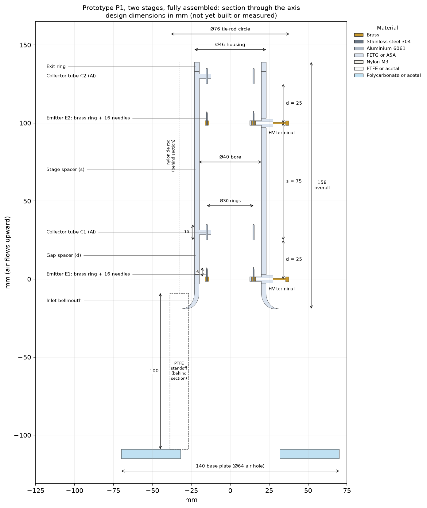
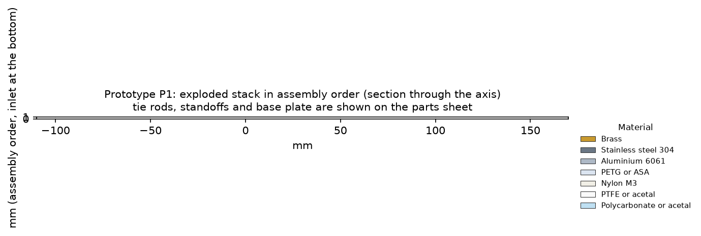
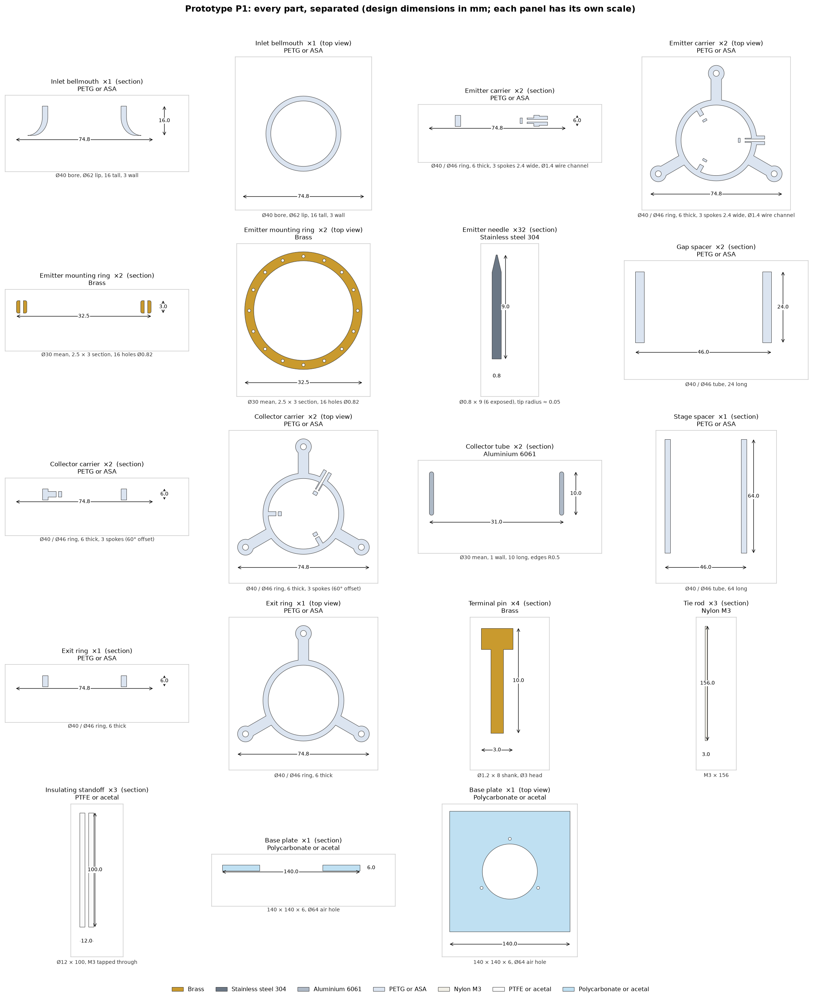

# Prototype P1: two-stage build package

**Status: designed, not yet built.** All dimensions here are **design dimensions** from the
parametric CAD model (`cad/build.py`). They are not measurements of a physical part. The
"as built" and "measured performance" tables below are blank, ready to fill in once P1 is built
and tested under the conditions in [`docs/safety.md`](../docs/safety.md).

Regenerate everything in this folder with `.venv/bin/python prototypes/build_drawings.py`.

## Fully assembled

| Key dimension | Value (mm) |
|---|---|
| Overall length (inlet flare to exit ring) | 158 |
| Bore / housing outside diameter | Ø40 / Ø46 |
| Emitter and collector ring diameter | Ø30 |
| Emitter-to-collector gap, d (both stages) | 25 |
| Collector to next emitter, s | 75 (3 × d) |
| Needle exposed length / tip radius | 6 / ≈ 0.05 |
| Collector tube length / wall | 10 / 1 |
| Tie-rod circle | Ø76 |
| Test-stand height (standoffs) / base plate | 100 / 140 × 140 |

## Separated parts

3-D versions: [`P1_viewer_exploded.html`](P1_viewer_exploded.html) (interactive; open in a browser) and
`P1_exploded.stl`. Individual part STLs are in [`../cad/stl/`](../cad/stl/).

## Parts and materials

| Part | Qty | Material | Key dimensions (mm) | Mass each (g) | Why this material |
|---|---|---|---|---|---|
| Emitter needle | 32 | **Stainless steel 304** | Ø0.8 × 9, 6 exposed, tip ≈ 0.05 | 0.03 | Holds a sharp tip longer than copper and resists ozone/NOx. Commercial needles give consistent tips. |
| Emitter mounting ring | 2 | **Brass** (copper alloy) | Ø30 mean, 2.5 × 3 section, 16 × Ø0.82 holes | 5.7 | Easy to machine and to solder the HV wire to. Plain copper also works. Conductivity doesn't matter at these currents. |
| Collector tube | 2 | **Aluminium 6061** | Ø30 mean, 1 wall, 10 long, edges R0.5 | 2.5 | Light, cheap, stable oxide. A thin tube aligned with the flow blocks the least air. |
| Terminal pin | 4 | **Brass** | Ø1.2 × 8, Ø3 head | 0.2 | HV feed to emitters and ground return from collectors |
| Emitter carrier | 2 | **PETG or ASA** (3-D printed) | Ø40/Ø46 ring, 6 thick, 3 spokes | 6.1 | Insulating. More ozone-tolerant than PLA. |
| Collector carrier | 2 | **PETG or ASA** | Ø40/Ø46 ring, 6 thick, spokes at 60° offset | 6.1 | The offset spokes lengthen the surface leakage path |
| Inlet bellmouth | 1 | **PETG or ASA** | Ø40 bore, Ø62 lip, 16 tall | 11.4 | A smooth inlet reduces entry loss |
| Gap spacer | 2 | **PETG or ASA** | Ø40/Ø46 tube, 24 long | 12.3 | Sets d. Print extra lengths to test other gaps. |
| Stage spacer | 1 | **PETG or ASA** | Ø40/Ø46 tube, 64 long | 32.9 | Sets s |
| Exit ring | 1 | **PETG or ASA** | Ø40/Ø46 ring, 6 thick | 5.8 | Clamps the stack |
| Tie rod | 3 | **Nylon** | M3 × 156 | 1.3 | Insulating clamp. No metal path along the device. |
| Insulating standoff | 3 | **PTFE or acetal** | Ø12 × 100, M3 tapped | 23.3 | Isolates the thruster from the balance (test stand only) |
| Base plate | 1 | **Polycarbonate or acetal** | 140 × 140 × 6, Ø64 air hole | 117.8 | Rests on the balance. The hole lets air reach the inlet. |

**Thruster mass (without stand): about 121 g.** Full list with envelopes and processes: [`P1_parts_list.csv`](P1_parts_list.csv).

**Also needed (not modelled):** silicone-insulated HV wire (rated above 30 kV, about 0.5 m),
6 × M3 nylon nuts, a cyanoacrylate or epoxy adhesive for the needles, and fine abrasive paper to
round the collector edges. Test equipment (HV supply, enclosure, balance, meters): see
[`experiments/test_plan.md`](../experiments/test_plan.md).

## Assembly sequence (all with no power connected)
1. Print the PETG/ASA parts with at least 3 perimeters, so the walls are solid and leak-free. Check the bore is Ø40 ± 0.2.
2. Press the 16 needles into each brass ring, tips all on one side, each sticking out 6.0 mm. Fix them with a drop of adhesive.
3. Solder the HV wire to each brass ring. Thread it through the 0° spoke channel of an emitter carrier and out to its terminal pin.
4. Snap each ring into its emitter carrier seat with the needles pointing **downstream** (toward the exit ring).
5. Round and deburr both collector tubes, press each into a collector carrier, and connect the ground wire to its terminal pin.
6. Stack from the bottom: inlet bellmouth, emitter carrier 1, gap spacer, collector carrier 1, stage spacer, emitter carrier 2, gap spacer, collector carrier 2, exit ring.
7. Fit the three nylon tie rods through the lugs and tighten the nuts evenly by hand.
8. Screw the tie rods into the PTFE standoffs, and the standoffs onto the base plate, exhaust pointing up.

## As-built dimensional check (fill in after building)

| Check | Design | Tolerance | As built |
|---|---|---|---|
| Gap d, stage 1 (needle ring plane to collector leading edge) | 25.0 | ±0.5 | |
| Gap d, stage 2 | 25.0 | ±0.5 | |
| Spacing s | 75.0 | ±1.0 | |
| Needle exposed length (mean of 16, both rings) | 6.0 | ±0.3 | |
| Needle tip radius (microscope, 4 sample needles) | ≈ 0.05 | n/a | |
| Ring concentricity to bore | 0 | ≤ 0.3 | |
| Collector edge radius | ≥ 0.5 | n/a | |
| Thruster mass | ≈ 121 g | n/a | |

## Measured performance (empty until tested)

Model predictions are listed so the measurements can be compared directly. The space-charge
predictions treat each needle ring as a continuous ring, so expect differences. Record raw data in
[`experiments/templates/`](../experiments/templates/).

| Quantity | Model prediction | Measured |
|---|---|---|
| Sparkover voltage, stage gap | ≈ 23–24 kV (assumes 1 MV/m mean field) | |
| Corona onset voltage | ≈ 6 kV (3-D needle model) | |
| Current at 19.5 kV | ≈ 65 µA, both stages (space-charge solver) | |
| Back-flow, stage 2 → collector 1 | ≈ 6 % (space-charge solver) | |
| Thrust at 19.5 kV | ≈ 3 mN | |
| Thrust/power at 19.5 kV | ≈ 2.3 mN/W | |
